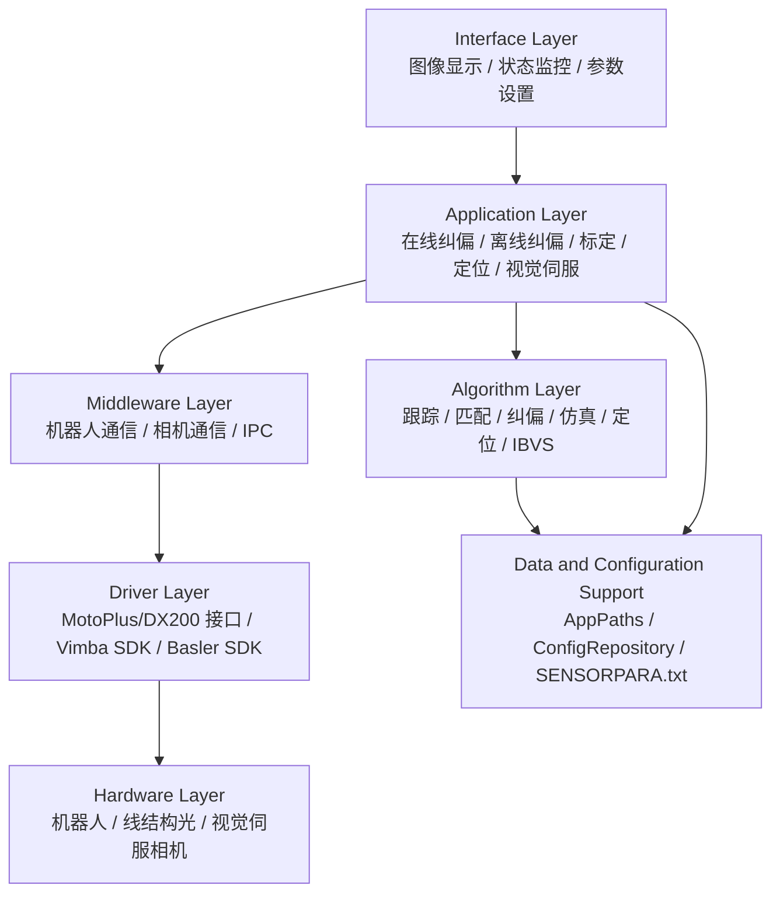

# 分层系统架构

## 目的

本文记录视觉仿真与纠偏系统已经确认的功能分层架构，并将其映射到当前 `i2r_rlc` 实现模块。

功能层和代码模块布局不是互斥设计。功能层描述从 UI 到硬件的系统职责；当前代码模块包括 `ui`、`ibvs`、`control`、`vision`、`localization`、`RobotComm`、`camera` 和 `digital_twin`。

不要仅为了匹配层名而重命名当前代码目录。

## 分层概览

## 分层职责与模块映射

| 层 | 职责 | 包含功能 | 当前代码模块 | 首版状态 | 后续是否需要真实 SDK/硬件 |
| --- | --- | --- | --- | --- | --- |
| Interface layer | Show images, status, logs, controls, menus, parameters, and user intent. It must not own device control or heavy algorithms. | 图像显示、状态监控、菜单响应、参数设置。 | `ui`, especially `MainWidget`; view-model signals from `app`. | Implemented as a minimal `QWidget` skeleton. | No. |
| Application layer | Coordinate use cases and workflows. It decides when calibration, tracking, correction, localization, simulation, or IBVS can run. | 在线纠偏、离线纠偏、系统标定、全局定位、局部定位、视觉伺服。 | `ui`, `control`, and module-owned workflow models. `UiController` coordinates; `COnlineCorrectionController` owns the current online correction state. | OnlineCor change 主链路已形成事件驱动控制器；真实机器人发送仍保持 dry-run DTO 边界。 | Later, for live robot/camera workflows. |
| Algorithm layer | Compute domain results from explicit data inputs. It should be testable and avoid UI dependencies. | 跟踪算法、轨迹匹配算法、纠偏算法、全局定位、局部定位、视觉伺服算法。 | `vision`, `localization`, `ibvs`, algorithm-facing parts of `control`; virtual references come through `digital_twin`; pure data lives in owning module headers. | Only interfaces/no-op placeholders. | OpenCV and PCL for local algorithms; RobotSim IPC for virtual references; YOLO/ONNX only if IBVS/detection needs it. |
| Middleware layer | Provide PC-side communication boundaries and protocol adaptation. It hides transport details from application workflows. | 机器人通信、相机通信、平台桥接 IPC. | `camera`, `RobotComm`, `digital_twin`; later worker/service facades. | Offline camera and dry-run robot only. | Yes for Vimba/Basler/DX200 transport; IPC only if confirmed. |
| Driver layer | Bind to vendor/runtime APIs or external controller-side interfaces. | MotoPlus/DX200 控制器接口、Vimba SDK、Basler SDK. | Adapter classes inside `camera` or `RobotComm` when introduced. | Not implemented. | Yes. |
| Hardware layer | Physical devices and controller-side programs. Not compiled into the PC Qt application. | 机器人系统、线结构光传感器、视觉伺服相机。 | None inside Qt code. Represented by interfaces, mocks, dry-run, and configuration. | Not implemented in Qt. | Physical hardware required for integration. |
| Data and configuration support | Provide runtime paths, calibration files, workpiece/job/model locations, and validation. It supports many layers rather than being one business layer. | `SENSORPARA.txt`, runtime data layout, camera/robot/calibration/workflow config. | `ui` support classes and `localization` calibration data. | Minimal path/config skeleton exists; parser is next. | No real hardware required for parser; later config feeds hardware adapters. |

## MotoPlus / DX200 边界

MotoPlus/DX200 should be treated as a robot controller-side interface or protocol peer from the PC Qt application's point of view.

The PC-side Qt program should not compile MotoPlus controller code directly. It should communicate with the DX200/MotoPlus side through a `RobotComm` boundary such as:

- `DX200RobotClient`;
- `RobotComm dry-run`;
- `RobotComm dry-run`;
- `ProtocolParser`;
- `ProtocolSerializer`;
- `RobotCommunicationWorker`.

Until protocol fields, test environment, and operator authorization are confirmed, the default PC-side behavior remains mock/dry-run and must not send real motion commands.

## 与当前 Qt 模块的关系

| 代码模块 | 主要层关系 | 说明 |
| --- | --- | --- |
| `ui` | Interface layer | Owns QWidget classes only. |
| `ui` | Interface and MVC coordination | Owns QWidget classes and current `UiController`. |
| `control` | Application layer and algorithm orchestration | Owns workflow state and control-loop boundaries; should not own SDK handles. |
| `vision` | Algorithm layer | OpenCV-first image processing and weld detection later. |
| `localization` | Algorithm layer | Global/local localization, point-cloud registration, and geometry-constrained pose correction. |
| `digital_twin` | Middleware-facing algorithm support | RobotSim facade for virtual references and simulation state; it does not solve localization. |
| `ibvs` | Algorithm layer and application feature boundary | Interface/mock/no-op first; Basler/IBVS later. |
| `camera` | Middleware and driver adapter boundary | Offline backend now; Vimba/Basler adapters later. |
| `RobotComm` | Middleware and driver/protocol adapter boundary | Dry-run now; DX200 client later. |
| `RobotComm` | Middleware | Protocol parser/serializer and transport boundaries. |
| module-owned public headers | Shared domain model | Cross-layer data types with explicit units live in owning modules. |
| `ui` support classes | Cross-cutting support | App paths, config repository, logging, and current MVC shell helpers. |
| `tests` | Verification support | Unit, replay, protocol, and workflow tests. |

## 首版范围

The first functional version remains weld tracking main workflow first:

- Interface layer: minimal `MainWidget` is present.
- Application layer: `UiController` and `COnlineCorrectionController` are present; the old no-op workflow controller has been removed.
- Algorithm layer: vision now uses `CWeldVisionAlgorithmPipeline` as the OpenCV-only algorithm orchestration entry. `LocalizationService` and `IbvsService` remain placeholders. `DigitalTwinService` is still a RobotSim-facing no-op facade.
- Middleware layer: offline camera and dry-run robot are present.
- Driver/hardware layers: not implemented in Qt and not required for the skeleton.
- Data/config support: next step is `AppPaths`, `ConfigRepository`, and `SENSORPARA.txt` parser implementation.

## 配置解析器定位

The fourth-stage `AppPaths`, `ConfigRepository`, and `SENSORPARA.txt` parser work is data and configuration support. It serves:

- system calibration in the application layer;
- online and offline correction workflows;
- global/local localization workflows;
- image-point to space-point conversion in the algorithm layer;
- visual simulation inputs;
- correction calculation inputs;
- later Vimba/Basler/DX200 adapter configuration.

It is therefore a prerequisite support capability, not a separate user-facing feature detached from the layered architecture.
