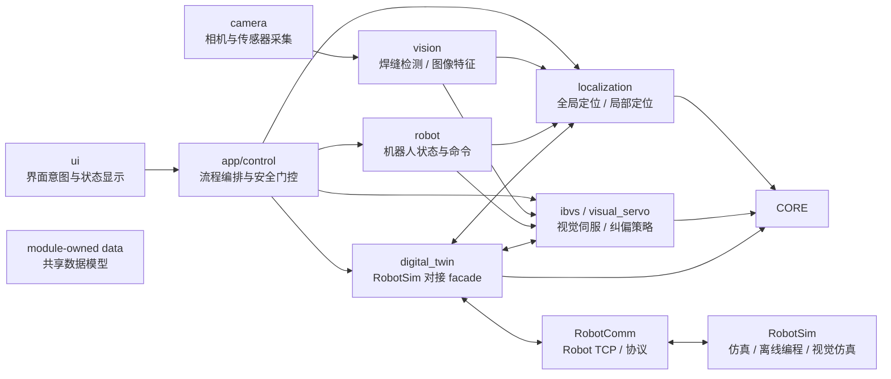

# 定位、视觉伺服与数字孪生职责说明

## 目的

本文用于辅助后续开发定位纠偏相关能力，重点梳理旧项目中全局定位、局部定位、视觉伺服和数字孪生的框架、流程、依赖和重构边界。

本文不展开具体算法公式、协议字段或 IPC schema。实现前仍需回到旧项目源码、当前架构文档和实际数据文件中确认细节。

## 项目职责定位

重构后的 Qt 项目是定位纠偏系统的一部分。当前重点职责可以理解为：

| 模块 | 新项目中的定位 | 主要职责 |
| --- | --- | --- |
| 定位模块 | 应用模块 | 负责全局定位、局部定位的流程编排、算法调用、输入输出建模和结果状态管理。 |
| 视觉伺服模块 | 应用模块 | 负责基于视觉观测的在线定位/纠偏方法。IBVS 是其中一种重要策略，也会与 LVS/贴缝约束共享部分状态。 |
| 数字孪生模块 | 中间模块 | 负责与 RobotSim 同步状态、请求虚拟数据、接收仿真结果，为定位和视觉伺服提供虚拟参考。 |

视觉采集、界面操作、机器人通信、标定和焊缝检测不是完全无关的外部能力；后续开发中可能需要共同参与这些模块。但它们在架构上应作为定位、视觉伺服和数字孪生的输入、输出或协作服务，而不是重新混入一个单体控制类。

## 旧项目内容梳理

### 全局定位

旧项目中的全局定位默认指离线扫描后的整件工件位姿修正，主要入口集中在：

- `oldproject/sontech-works-version-storage/SWv1/robotleadingDlg.h`
- `oldproject/sontech-works-version-storage/SWv1/robotleadingDlg.cpp`
- `oldproject/sontech-works-version-storage/SwBase/virtualLocation.h`
- `oldproject/sontech-works-version-storage/SwBase/virtualLocation.cpp`

主要链路有两条：

1. 基于虚拟定位元件特征向量的几何约束定位：
   `updateGeoDataVec()` -> `updateModelOffline()` -> `vloc::computeLocation()`。
2. 基于受限自由度 ICP 的整体点云配准：
   `updateModelOfflineICP()`。

旧项目依赖 PCL 点云类型、PCL 法向/滤波/采样/分割能力、Eigen 矩阵、`Weldment` 工件模型和 OpenCascade 场景对象。重构时不应直接复制这些依赖链，而应先抽象全局定位输入输出：真实观测、虚拟参考、定位约束、初始位姿、自由度约束和定位结果。

### 局部定位

旧项目中的局部定位默认指在线识别或焊接过程中，利用仿真激光线、局部虚拟点云、当前真实中心线/真实点云，对当前工件位姿进行滑窗式修正。

主要入口包括：

- `OnUpdateModelPosition()`
- `drawVirtualLaserLine()`
- `generateVirtualPointCloud()`
- `updateVirtualPointCloud()`
- `updateRealPointCloud()`
- `VS_ONLINE_REC_MOD` 相关流程状态

局部定位在旧项目中强依赖数字孪生状态：真实机器人/变位机状态映射到虚拟场景，虚拟线结构光传感器生成 ROI、焊缝点和局部点云，再与真实视觉结果进行匹配或 ICP 修正。

重构后，局部定位模块不应直接持有虚拟传感器、OCCT viewer 或 PCL 可视化对象。它应通过数字孪生模块获取虚拟参考，通过视觉/采集模块获取真实观测，通过机器人模块获取当前姿态，再输出定位误差、位姿修正或纠偏建议。

### 视觉伺服

旧项目中的视觉伺服重点代码主要分布在：

- `oldproject/sontech-works-version-storage/SWv1/IBVS.h`
- `oldproject/sontech-works-version-storage/SWv1/IBVS.cpp`
- `oldproject/sontech-works-version-storage/SWv1/PicCapture.cpp`
- `oldproject/sontech-works-version-storage/SWv1/InitPointDetector.cpp`
- `oldproject/sontech-works-version-storage/SWv1/YoloDetector.h`
- `oldproject/sontech-works-version-storage/SWv1/RedFeatureDetector.h`
- `oldproject/sontech-works-version-storage/SWv1/robotleadingDlg.cpp`
- `oldproject/sontech-works-version-storage/Robotleading/robotleading_method/RStdAfx.h`

快速理解旧视觉伺服主链路时，可按：
`robotleadingDlg` -> `RStdAfx` -> `PicCapture` -> `IBVS` -> `RobotCtrl`。

旧项目中 `VS_IBVS` 被作为视觉伺服模式，和 Basler/Pylon 相机、IBVS 求解、YOLO/红色特征检测、手眼标定、LVS/IBVS 全局状态以及机器人通信耦合在一起。

重构后，视觉伺服应被视为定位/纠偏方法的一种，但仍保留独立模块视角，原因是它有独立的相机、特征、控制周期、安全约束和输出形式。后续可以保留 `ibvs` 作为具体策略模块，也可以在架构上进一步抽象为 `visual_servo`，让 IBVS 成为其中一种实现。

### 数字孪生

旧项目中的数字孪生不是单纯显示模块，而是视觉仿真、离线全局定位、在线局部定位、IBVS/LVS 几何约束共用的运行底座。

主要涉及：

- `robotleadingDlg.cpp` 中的 `virtualSceneThreadFunc()`、仿真按钮、模型位姿更新和点云显示逻辑；
- `SwBase/SwMySensor.*` 中的虚拟线结构光传感器能力；
- `SwBase/virtualLocation.*` 中的定位几何与点云处理；
- `Weldment`、`SwRobot`、`SwLSLSensor`、OpenCascade 场景和 PCL 点云。

重构后，数字孪生模块默认不在 Qt 项目内重新实现 OCCT/PCL/VTK 三维仿真。机器人仿真、离线编程、三维显示、虚拟传感和视觉仿真应优先由 `RobotSim` 提供。新项目中的数字孪生模块应作为 RobotSim 对接 facade，负责状态同步、IPC 调用、数据转换、服务状态和错误边界。

## 新项目模块边界

建议将负责内容整理为以下模块边界：

| 新模块或现有模块 | 建议职责 |
| --- | --- |
| `localization` | 定位模块，承载全局定位、局部定位的请求、结果、流程状态和算法适配。PCL 点云预处理、ICP/配准、几何约束定位等定位求解能力归入该模块。 |
| `ibvs` / `visual_servo` | 视觉伺服能力边界。当前已有 `ibvs` no-op 服务；后续专门承载视觉伺服状态、控制周期和伺服输出，不混放普通定位算法。 |
| `digital_twin` | RobotSim 对接 facade。向定位/视觉伺服提供虚拟参考、仿真状态、虚拟激光线或虚拟点云，不负责真实/虚拟点云配准和定位求解。 |
| `vision` | 焊缝检测、图像特征、中心线等视觉结果提供方。定位和视觉伺服消费其输出。 |
| `camera` | 离线图像、Vimba、Basler 或自有传感器采集边界。定位和视觉伺服不直接管理 SDK 生命周期。 |
| `RobotComm` | 机器人状态、命令、安全门控、RobotSim IPC 或 DX200 通信边界。 |
| `control` | 上层工作流和安全状态机。可以编排定位、视觉伺服、采集、机器人和数字孪生服务。 |
| module-owned public data | 共享数据模型归属各模块公开头，例如定位结果在 `localization`、视觉伺服状态在 `ibvs`、数字孪生状态在 `digital_twin`。 |

## 模块关系

## 依赖取舍

新项目默认应保持职责轻量化，而不是放弃定位算法依赖：

- 必选基础依赖：Qt Widgets、Qt Core/Gui、OpenCV。
- 定位模块必选或阶段性必选依赖：Eigen、headless PCL。PCL 只用于 `localization` 内部的点云预处理、ICP/配准、特征提取和几何定位，不暴露到公共 UI/流程接口。
- 按阶段接入：Vimba、Basler/Pylon、自有传感器 SDK、Qt Network 或 RobotSim IPC 所需通信库。
- 默认不直接引入：OpenCascade、VTK、Chrono、PQP、旧 MFC 控件和旧工程规划库。
- ONNX Runtime 仅在视觉伺服或检测模型明确需要时作为可选能力接入。
- HALCON 仅在无法替代的旧算法或数据格式需要时作为可选 legacy adapter 接入。

RobotSim 负责虚拟参考生成、仿真、三维显示和离线编程；新项目中的 `localization` 负责使用真实观测和虚拟参考完成定位求解。需要避免的是把 PCL 可视化、VTK viewer、OCCT 场景对象或 RobotSim 内部仿真依赖带进 Qt 主工程。

## 与现有架构的关系

当前已有架构并不冲突：

- `digital_twin` 已经存在 no-op 服务，可演进为 RobotSim 对接 facade。
- `ibvs` 已经存在 no-op 服务，可作为视觉伺服策略边界继续保留。
- `localization` 应作为独立模块新增，承载全局定位、局部定位和点云配准。
- `control` 可继续承担流程编排和安全门控，不应吸收具体定位算法实现。
- `vision`、`camera`、`RobotComm`、`digital_twin` 是定位/视觉伺服的协作模块，而不是必须由单一开发者完全拥有的孤立模块。
- 避免把全局定位、局部定位塞入 `digital_twin`、`vision`、`ibvs` 或 `control` 任一单独模块中。

需要特别避免旧项目中的几类耦合：

- 不把 `CRobotleadingDlg` 的 UI、线程、状态机、仿真和算法混合方式搬到 Qt `QWidget`。
- 不把 `RStdAfx.h` 中的全局状态继续作为模块通信方式。
- 不让 worker 线程直接更新 UI。
- 不让定位或视觉伺服模块直接拥有相机 SDK、机器人 socket 或 RobotSim 进程生命周期。

## 后续开发建议

1. 先定义定位、视觉伺服、数字孪生的输入输出数据结构和服务接口，再迁移具体算法。
2. 全局定位和局部定位应共享基础位姿、观测和结果模型，但流程状态可以分开。
3. 视觉伺服模块应明确输入观测、控制周期、安全约束和输出命令类型，真实机器人运动默认保持 dry-run 或显式授权。
4. 数字孪生模块先实现 RobotSim 连接状态、请求/响应边界和数据同步语义，再考虑缓存、重试和性能。
5. 旧项目代码只作为行为参考。迁移时优先保留业务语义和数据流，不保留 MFC 消息、raw thread、全局变量和重型三维依赖形态。
