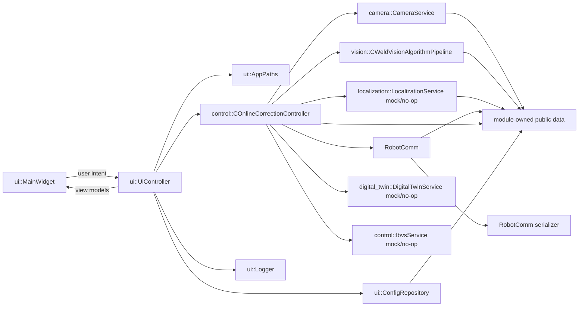

# 新 Qt Widgets 架构

## 目标

新应用是独立 Qt Widgets 应用。顶层窗口应采用 `QWidget` 组合方式，例如 `MainWidget`；它不是 MFC `CRobotleadingDlg` 的直接复制，也不默认使用 `QMainWindow`，除非后续需求证明确有必要。

`MainWidget` 必须保持轻量。它只显示状态、收集用户意图并发出信号，不持有相机 SDK handle、机器人 socket、图像处理循环、workflow 状态机或文件路径策略。

首版优先焊缝跟踪主流程。数字孪生和 IBVS 在真实实现排期前，只通过接口和 mock/no-op 服务表示。

## 建议模块布局

| 模块 | 职责 | Qt Widgets 依赖 |
| --- | --- | --- |
| `ui` | UI, MVC controller/view-model state, application startup coordination, and service wiring. Owns `MainWidget` and `UiController`. | May depend on Qt Core and Qt Widgets for startup. |
| `ui` | `MainWidget` and smaller QWidget panels for camera view, robot status, weld tracking controls, calibration controls, logs. | Yes, this is the only module that should own QWidget classes. |
| module-owned public headers | Pure domain data lives with the module that owns it, such as camera frames in `camera`, vision results in `vision`, online correction state in `control`, and calibration/localization data in `localization`. | Prefer pure C++ value types; UI text conversion stays in `ui`. |
| `vision` | Image preprocessing, centerline extraction, weld seam detection, image-to-space conversion, gap detection, algorithm adapters. | No Qt Widgets. OpenCV is the preferred image dependency. HALCON is optional and isolated. |
| `camera` | Camera abstraction, backend adapters, acquisition worker, frame timestamping. | No Qt Widgets. Qt Core allowed for worker/signals. |
| `RobotComm` | Robot communication production library, message serialization, queueing, and future DX200 adapter boundary. | No Qt Widgets. Pure C++ preferred. |
| RobotComm internals | TCP/ZeroMQ client, protocol serialization, and connection lifecycle live inside `RobotComm` or `digital_twin` by peer type. | No Qt Widgets. Qt Network or platform sockets behind an interface. |
| `localization` | Global localization, local localization, point-cloud preprocessing, ICP/registration, geometry-constrained pose correction. | No Qt Widgets. PCL should stay inside this module and not leak into public UI/control interfaces. |
| `digital_twin` | RobotSim facade for virtual robot state, virtual laser sensor output, virtual point clouds, and simulation results. It provides references to localization/IBVS but does not solve localization. | No Qt Widgets. Visualization boundary should be RobotSim-side or separate. |
| `control` | `COnlineCorrectionController`, correction orchestration, safety gates, optional IBVS/LVS coordination interfaces. | No Qt dependency; UI display text is converted in `ui`. |
| `ui` support classes | `ConfigRepository`, `AppPaths`, logging, file paths, and current MVC shell support. | No Qt Widgets. |
| `tests` | Unit, integration, replay, and protocol tests. | No Qt Widgets unless testing UI separately. |

## 系统功能层与代码模块

The confirmed system functional layers are: interface layer, application layer, algorithm layer, middleware layer, driver layer, and hardware layer. These layers describe system responsibilities. The current directories under `src/` describe implementation modules. They are not in conflict and should not force large directory renaming.

| 功能层 | 含义 | 当前模块映射 |
| --- | --- | --- |
| Interface layer | Image display, status monitoring, menu response, parameter setting, and user intent. | `ui`; `MainWidget` belongs here and must remain a thin QWidget. |
| Application layer | Online correction, offline correction, system calibration, global localization, local localization, and visual servo workflows. | `ui` for MVC coordination and `control` for workflow/control state. `UiController` is application coordination; `COnlineCorrectionController` is the current OnlineCor process control entry. |
| Algorithm layer | Tracking, trajectory matching, correction math, local/global localization, and visual servo algorithms. | `vision`, `localization`, `ibvs`, and algorithm-facing parts of `control`; virtual references come through `digital_twin`; pure data lives in owning module headers. |
| Middleware layer | PC-side robot communication, camera communication, and possible platform bridge IPC. | `camera`, `RobotComm`, `digital_twin`; these modules expose interfaces and hide transport details from application workflows. |
| Driver layer | Vendor SDK or controller-side adapter boundary. | Future Vimba/Basler adapters in `camera`, future DX200 protocol/client adapters in `RobotComm`. MotoPlus/DX200 controller code is not compiled into the Qt program. |
| Hardware layer | Physical robot system, line-structured-light sensor, and visual-servo camera. | Not implemented inside the Qt project; represented only by interfaces, configuration, mocks, and dry-run services. |
| Cross-cutting support | Runtime paths, configuration, calibration, logging, errors, and worker helpers. | `ui` support classes and module-owned public data; this is horizontal support, not one business layer. |

MotoPlus/DX200 should be treated by the PC Qt application as a robot-controller interface or communication protocol peer. The Qt program should own only the PC-side adapter, parser/serializer, mock, and dry-run boundaries.

## 顶层组合

## 数据流

1. User clicks a UI command in `MainWidget`, such as load configuration, start offline replay, start Vimba tracking camera, connect robot in dry-run mode, or start weld tracking.
2. `MainWidget` emits a signal carrying typed user intent.
3. `UiController` validates whether the command is allowed in the current workflow state.
4. Backend services run in workers or service objects:
   - camera emits `Frame` snapshots from `OfflineImageCameraBackend`, `VimbaTrackingCameraBackend`, or later `BaslerIbvsCameraBackend`;
   - robot emits `RobotState` snapshots from `RobotComm dry-run`/`RobotComm dry-run` by default;
   - vision emits `WeldVisionPipelineResult` or `WeldVisionPipelineResult`;
   - control emits `RobotCorrectionCommand`, `OnlineCorrectionPhase`, and safety/error events;
   - optional digital twin and IBVS services emit mock/no-op availability/status in the first release.
5. `UiController` aggregates these events into view models.
6. `MainWidget` receives view-model updates on the UI thread and updates widgets.

## UI Signal/Slot 契约

UI 只应表达意图和显示状态。

用户意图信号示例：

| UI 信号 | 后端接收方 | 预期后端行为 |
| --- | --- | --- |
| `loadConfigurationRequested()` | `UiController` | Load paths/config through `ConfigRepository`. |
| `connectRobotRequested()` | `UiController` | Start mock/dry-run robot client unless real DX200 is explicitly enabled and authorized. |
| `startCameraRequested(CameraId)` | `UiController` | Start configured `CameraWorker`. |
| `startOfflineReplayRequested(JobId)` | `UiController` | Use `OfflineImageCameraDevice` for replay tests. |
| `startWeldTrackingRequested()` | `COnlineCorrectionController` | Start OnlineCor initial detection state; full closed-loop execution remains a later integration task. |
| `stopRequested()` | `UiController` | Request safe stop and worker shutdown/idle transition. |

后端到 UI 的信号示例：

| 后端信号 | UI 目标 |
| --- | --- |
| `robotStateChanged(RobotState)` | Robot status panel. |
| `frameReady(FrameView)` | Camera/image panel. |
| `visionResultReady(WeldVisionPipelineResult)` | Overlay layer and status panel. |
| `onlineCorrectionStateChanged(OnlineCorrectionPhase)` | Process controls. |
| `digitalTwinStateChanged(ServiceState)` | Optional status indicator. |
| `ibvsStateChanged(ServiceState)` | Optional status indicator. |
| `errorRaised(AppError)` | Log/status panel and user notification. |

## 不得依赖 Qt Widgets 的模块

以下模块不应 include `<QWidget>`、`<QLabel>`、`<QPushButton>` 或任何 Qt Widgets 头文件：

- module-owned public data headers
- `vision`
- `camera`
- `RobotComm`
- `digital_twin`
- `control`
- current `ui` support classes

These modules may use Qt Core for `QObject`, `QThread`, signals/slots, `QString`, `QDateTime`, and `QByteArray` if that simplifies integration. However, pure C++ value types are preferred for domain models and algorithm inputs/outputs.

## 图像处理依赖策略

- OpenCV is the preferred image-processing dependency for new weld tracking code, replay tests, and algorithm migration.
- HALCON is not a priority acquisition path and should not be introduced into the minimal skeleton.
- A `HalconCameraBackend` or HALCON algorithm adapter may be added later only as an optional isolated legacy compatibility layer when a specific old algorithm or data format cannot be replaced by OpenCV.

## 焊缝检测接口边界

Stage 8 introduced the first stable weld-detection result boundary. The old Qt-facing adapter has since been removed so the current boundary is:

- `vision::CWeldVisionAlgorithmPipeline` owns reusable result data such as `PixelPoint`, `ImageRoi`, `WeldCenterline`, `WeldDetectionStatus`, and `WeldVisionPipelineResult`.
- `vision::WeldVisionPipelineResult` owns the single-frame result passed from UI/application coordination into workflow control.
- `vision::CWeldVisionAlgorithmPipeline` is the OpenCV-only algorithm orchestration entry for the migrated SWv1 `ImagePro` route.
- `ui::UiController` adapts `CameraFrame/QImage` into `CV_8UC1 cv::Mat` before calling `CWeldVisionAlgorithmPipeline`.
- The old `vision::IWeldDetector`, `vision::StubWeldDetector`, `vision::OpenCvImageUtils`, and `vision::VisionPipeline` adapter were removed to avoid a duplicate pipeline and Qt adapter surface inside `vision`.

`CWeldVisionAlgorithmPipeline` 不应成为旧 `ImagePro` 的新大杂烩类。它只负责按任务组合子模块：

- `vision/preprocess` 提供灰度、形态学、方向滤波和 `CImageQualityEvaluator` 等输入质量能力。
- `vision/stripe` 提供激光条纹/中心线提取与修复，包括 LOG/CoM、SAM、ISFFA、Steger-like、骨架和单列响应评价。
- `vision/geometry` 提供 split line、RANSAC、交点、affine/ICP 等纯几何能力。
- `vision/feature` 提供焊缝语义特征，包括 T/对接/搭接、gap、主动轮廓和 `CWeldStartPointDetector`。
- `vision/feature` 提供焊缝语义特征、仿真激光线模板定位和仿真线配准。
- `vision/pipeline` 只做任务路由、状态持有、失败原因聚合和结果转换。旧 `GetDetImagePt(type)` 的兼容映射在这里完成：`type=0/1/2/3/4` 分别进入 SAM、ISFFA、Steger-like、主动轮廓和端点检测任务。旧焊缝类型模板初始化依赖 HALCON `.shm` 资源，当前不进入生产入口。

Real KCF/STC tracking, additional centerline routes, local localization, groove detection, visual simulation assistance, and correction observations should be composed behind the vision algorithm pipeline or a narrow detector interface. They must not be added to `MainWidget`, and `UiController` should remain orchestration-only.

## 适合纯 C++ 的候选内容

以下内容在可行时应保持纯 C++：

- robot protocol parser/serializer;
- `RobotState`, `CameraFrameMetadata`, `SensorCalibrationData`, `WorkpieceProfile`;
- image-point to 3D conversion math;
- trajectory correction math;
- centerline and gap detection kernels that can accept OpenCV matrices;
- IBVS numerical model and safety constraints when IBVS becomes active;
- config parsers once file content is loaded;
- workflow transition table if it can be expressed without QObject.

Pure C++ makes unit tests easier and avoids repeating the legacy mistake of binding algorithms to the UI framework.

## 服务边界

| 服务 | 持有 | 不持有 |
| --- | --- | --- |
| `CameraService` | Camera backend, acquisition lifecycle, frame emission | QWidget drawing, robot state |
| `RobotClient` / `RobotService` | Mock/dry-run/real client choice, robot state snapshots, outbound command validation | UI controls, image processing |
| `CWeldVisionAlgorithmPipeline` | OpenCV-only vision algorithm orchestration | Camera device, robot socket, widgets, Qt/QImage conversion |
| `COnlineCorrectionController` | Online correction state, orchestration, safety gate decisions | Raw device SDK handles, widget layout |
| `LocalizationService` | API for global/local localization requests and results; mock/no-op first | QWidget drawing, RobotSim process ownership, PCL types in public interfaces |
| `DigitalTwinService` | API for RobotSim virtual data; mock/no-op first | UI drawing widgets, localization solving, required skeleton dependency on OpenCascade/VTK |
| `IbvsService` | Optional API for IBVS state; mock/no-op first | First-release full Basler control loop |
| `ConfigRepository` | Paths, schemas, runtime configuration, validation | Business workflows |

## Legacy 全局变量替换

legacy 全局变量应替换为显式模型和事件流：

| Legacy 全局模式 | 新架构替代方案 |
| --- | --- |
| `sMode`, `sStart`, `traflag`, `curx` | `RobotState` emitted by `RobotClient`/`RobotService`. |
| `cv_image`, `G_LiveImage`, `Online_Ptr` | `Frame` emitted by `CameraService`. |
| `DetPtsList`, `NormalDetPts`, `TP` | Owned `TrackingSession` / `CorrectionSession` model. |
| `g_lvs_*`, `g_ibvs_*` | `LvsObservation`, `IbvsSessionState`, controller-owned state. |
| `RobotLeading_data_path` | `AppPaths` from `ConfigRepository`. |
| `SENSORPARA.txt` raw fields | `SensorCalibrationData` with explicit units. |

## 第一段可用架构切片

文档完成后，建议优先构建以下第一段可编译切片：

1. Qt Widgets `MainWidget` that only displays state and emits user-intent signals.
2. `UiController` that wires UI, config, mock camera, mock robot, and workflow interfaces.
3. module-owned data models including `CameraFrame`, `WeldVisionPipelineResult`, `OnlineCorrectionPhase`, and localization calibration data.
4. `ConfigRepository` and `AppPaths` defining runtime locations without relying on the current working directory.
5. `OfflineImageCameraBackend` or `MockCamera` for replay/testing.
6. `RobotComm dry-run` and `RobotComm dry-run` as the default robot implementations.
7. `CWeldVisionAlgorithmPipeline` interface, with OpenCV-ready data types but no hard dependency on real camera SDKs in the skeleton.
8. `COnlineCorrectionController` interface for the OnlineCor main workflow.
9. `LocalizationService` interface placeholder with mock/no-op implementation.
10. `DigitalTwinService` interface placeholder with mock/no-op implementation.
11. `IbvsService` interface placeholder with mock/no-op implementation.

This keeps the early build small and safe while creating stable integration points for Vimba tracking, DX200 protocol parsing, digital twin, and IBVS later.

