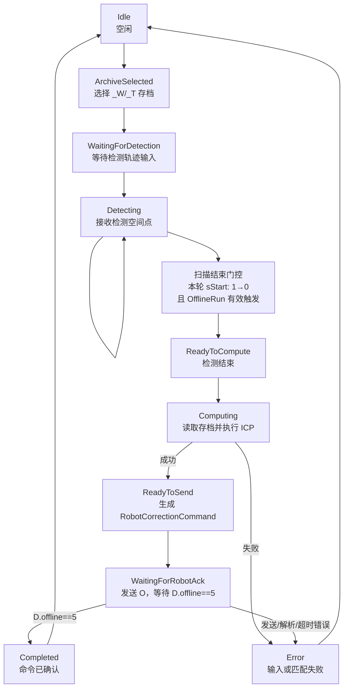

# OfflineCor 状态机

## 有匹配离线纠偏流程



## 边界说明

- 2026-09-06 起，离线纠偏使用只扫描焊缝的专用 JBI。已核对旧控制柜
  `WithinRobot/SensorCtrl.c`：`STARTDET/ENDDET` 控制 `traflag`；
  `WithinRobot/TcpSvr.c` 将 B040 读入 `OfflineRun`，B030 仅为保存轨迹信号。
  新程序不再包含全局定位的侧面扫描，Runtime 不再用 `posflag` 或
  `STARTPOSSEG` 次数筛选焊缝。图像按冻结的 `sStart/traflag` 检测窗口处理，
  有效 KCF 结果按其帧内 `traflag` 接收；多个检测窗口均允许采点。
  `ENDDET` 应放在退出运动之前，`SET B040 1` 放在主程序结束前；
  `STARTPOSSEG/ENDPOSSEG` 不再是离线纠偏的必要指令。
  此约定不兼容在检测窗口内继续扫描侧面的旧混合 JBI；全局定位仍保留自己的分段逻辑。
- `Control` 不启动相机、不运行 Vision 检测、不访问 Qt；检测点通过 `OfflineCorrectionDetectionEvent` 输入。
- Runtime 中由 `COfflineCorrectionWorkerAdapter` 启停 Vision tracking、累计
  `RuntimeTrackingResult` 空间点、发送机器人命令并消费 `RobotCommandReceipt`。
- `ReadyToSend` 表示已生成 `RobotCorrectionCommand`；随后通过
  `CRobotCommWorkerAdapter::sendCorrectionCommand()` 逐条发送旧 `O` 请求。
- 每次启动检测都会清除上一轮扫描、`OfflineRun` 和 O 命令确认状态。本轮必须先
  观察到 `sStart==1`，确认扫描 JBI 确实运行；扫描仍运行时只记录结束请求，不执行
  ICP，也不会进入完成阶段。
- 离线纠偏总流程结束使用旧工程的 `OfflineRun/OfflineStartCount` 握手，不再把
  `detflag==2/3` 当成扫描完成。`OfflineRun` 释放后出现本轮有效触发时回送
  `OfflineStartCount=1`，待其复位后回送 `0`。
- 仅当当前 O 命令的最后一个示教点回执同时满足 `receipt.completed` 和
  `RobotState.offline==5` 时进入 `Completed`。
- 进入 `Completed` 时覆盖保存 `output/offline_correction/` 中最近一次成功运行的
  五份 `.txt` 诊断文件。ICP 计算失败、O 命令失败或确认超时均不覆盖上一份记录。
- 离线检测只接入扫描 KCF 路径 `det_type==2`；其他 `det_type` 直接进入 `Error`，
  错误文本为 `offline correction currently supports scan/KCF det_type=2 only`。
- `RuntimeTrackingPurpose` 保证同一帧视觉结果只送入 OnlineCor 或 OfflineCor 之一。
- 无匹配、端点参数和补偿点配置不进入本状态机。

## 2026-09-06 专用焊缝扫描验证

- `test_offline_runtime_worker_flow.cpp` 更新为本轮预检、JBI 启动、B040 完成握手；
  覆盖 `posflag=0` 采点、多次定位段切换仍可采点、`traflag=0` 和无效结果拒收、
  旧 B040 预检复位，以及 B040 已到但 JBI 未停止时不得计算。
- 本轮只完成静态检查，未编译或执行这些测试。当前 Computer Use 不支持原生
  Visual Studio 操作，按仓库要求未使用命令行替代构建。需在 VS2022 生成后运行
  `i2r_rlc_offline_runtime_worker_flow_tests` 与
  `i2r_rlc_correction_robot_sim_offline_frame_sync_tests`。

## 最近一次成功运行诊断

控制柜以 `D.offline==5` 确认全部 O 点后，Runtime 使用原子文件替换方式覆盖
`output/offline_correction/` 下的固定文件：

```text
detection_points.txt
icp_transform.txt
transformed_model_points.txt
transformed_teach_points.txt
match_report.txt
```

三份点文件均为无表头、空格分隔的纯数值文本，点坐标单位为 mm；矩阵文件为
4 行 4 列。`match_report.txt` 使用 `key=value` 记录输入文件、点数、
误差、置信度和保存时间。固定文件名用于保留最近一次成功结果；失败运行不覆盖。

当前 Qt 路径直接求解模型到检测点变换并应用于示教点，诊断报告标记为
`transform_direction=model_to_detection`。Legacy `OffLineCor::ICPmatch()` 则先求
检测点到模型变换，再在 `GetChangeT()` 中求逆后作用到示教点。最近邻 ICP 目标并非
对称，后续评估配准质量时必须保留该迁移差异，不能只比较矩阵是否互逆。
