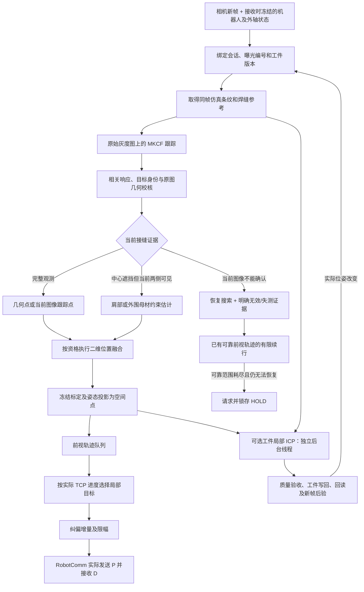
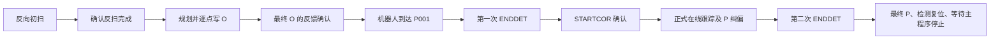

# 在线纠偏全过程：焊缝跟踪、辅助估计、定位与机器人跟随

更新日期：2026-10-28。依据当前工作区生产代码及本轮已完成的连续性修复编写。

本文说明界面“在线纠偏”所使用的实际处理链路：从反向初扫、相机图像与仿真参考，到三模板双特征跟踪、接缝定位、预焊估计、工件位姿刷新，再到机器人实时纠偏和结束。文中的数值是当前实现或配置快照，不是算法对任意工件的通用保证。

## 1. 先看整体：系统每一层分别解决什么问题

当前在线纠偏采用“当前图像定位为主，仿真提供辅助，检测轨迹供焊枪随后跟随”的策略。它包含几个连续但独立的判断：

1. 当前原图中的哪一处仍是同一条目标焊缝？
2. 中心接缝被遮挡时，剩余图像还能约束它到什么程度？
3. 这个图像位置能否可靠地投影到空间？
4. 检测位置什么时候到达焊枪下方，应如何生成平滑的机器人修正？
5. 虚拟工件与实际工件有偏差时，是否有足够证据更新虚拟工件位姿？



图中“工件局部 ICP”是旁路。关闭它以后，基本图像跟踪、空间检测和机器人跟随仍然工作。

### 1.1 几个容易混淆的名称

| 名称 | 在当前系统中的实际含义 |
|---|---|
| KCF 点 | 界面对在线焊缝位置结果的统称；其实际来源可能是几何、相关跟踪或受图像约束估计。 |
| 目标焊缝 | 希望焊枪跟随的母材接缝中心。预焊凸起的可见表面折点不自动成为新目标。 |
| 当前图像观测 | 当前曝光确实提供了位置证据；其中相关跟踪与独立几何测量仍需区分。 |
| 受图像约束估计 | 中心接缝不可完整见到，但当前肩部或外围母材仍约束位置。 |
| 仿真参考 | CAD/RobotSim 提供的条纹形状、方向、焊点及空间参考；绝对位置可能有摆放误差。 |
| 前置检测点 | 传感器看到的焊枪前方位置，焊枪稍后才会经过；不是 TCP 现在应立即追到的位置。 |
| 检测锚点 | 经过目标身份和几何确认的观测基准；显示估计不能自动刷新该基准。 |

### 1.2 三项资格必须分别看

**能显示位置、能更新实拍模板、能作为独立几何点参与工件定位，不是同一回事。**

例如：

- 清晰的当前图像相关跟踪，可以用于初扫或正式跟随，但不因此获得独立几何资格。
- 当前双侧母材支撑的估计可以在正式在线阶段续接，但不应训练可信实拍模板，也不能充当独立焊点。
- 某个局部双线拟合数学上成立，还必须核对它是否属于原来的目标焊缝，才能授予更高资格。
- 图像位置正确但空间投影失败，可以保留图像定位证据，但不能交付空间控制点。

## 2. 作业开始前：配置、参考和启动方式

在线控制至少需要以下数据：

| 数据 | 用途 |
|---|---|
| `_W` 工作轨迹 | 工作参考路径、分段和沿缝关系。 |
| `_T` 示教位姿 | 机器人姿态、外轴及路径模板。 |
| `RBCALIB.DAT` | 机器人与变位机之间的标定，必须含有效 `////SRANG` 记录。 |
| 相机与激光平面标定 | 把原图像素转换为空间点。 |
| 仿真场景及对象身份 | 提供与曝光绑定的虚拟条纹、焊点、工件及父级参考。 |
| 当前机器人状态 | 位置、姿态、外轴、运行/保持及检测/纠偏窗口状态。 |

缺少必要的轨迹或标定时，不应启动初始 O 点写入与在线 P 控制。

启动方式还需要区分：

- 普通初始检测：利用初扫得到的位置对齐当前工作段。
- 全局修正起点：先应用已经得到的全局变换，再处理初扫与起点对齐。
- 视觉伺服起点：使用专门的 IBVS 起点流程；它与本文以线结构光/MKCF 为主的正式在线跟踪不同。

一键全自动模式还可以先运行全局定位扫描 JBI，收集真实点云，完成全局配准后再启动在线 JBI。这个可选前置步骤不等于每一帧在线图像都在做全局定位。

## 3. 反向初扫：建立起点、图像模型及响应基线

### 3.1 初扫和正式焊接用的是同一条图像定位主线

反向初扫与正式在线均启用当前 `processPaperTracking` 路径：MKCF 三模板框架、HOG/灰度双特征、原图身份及几何校核、外围母材辅助。

差别主要在于用途与运行约束：

| 项目 | 反向初扫 | 正式在线 |
|---|---|---|
| 控制用途 | 采集起点/初始参考，准备 O 点 | 更新前视轨迹并生成实时 P |
| 估计点 | 不接纳为初始 O 依据 | 满足资格时可以续接跟随 |
| 搜索 | 使用初扫搜索流程 | 重捕获分帧执行，限制每曝光精定位开销 |
| 正常响应统计 | 从可信焊前观测积累 | 使用已有对应模型统计，不把在线异常收成正常样本 |
| 工件在线局部 ICP | 不启用本支路 | 开关允许且条件满足时启用 |

### 3.2 反扫结束后怎样得到 P001 和 O 批次

当前起点规划取反扫最后的有效检测点，按标定补回到所需的变位机末节坐标，然后：

1. 必要时先对 `_W/_T` 应用全局修正。
2. 分别将当前 `_W` 段和 `_T` 段的首点平移对齐到检测起点。
3. 生成需要写入控制柜的整批 O 点。
4. `InitType` 与 `GlobalCorrection` 的首个动态 P001 使用计算所得位置及 `_T` 首点的目标外轴；RobotBase 姿态取反扫完成反馈中的当前焊枪姿态。后续点继续使用 `_T` 模板姿态及各自外轴转换。

代码中虽然保留了一些初始路径匹配字段与距离阈值，但当前首点对齐流程不靠最近点匹配来裁决整批 O 点，不能仅看配置项名称就认为它实际参与了起点验收。

### 3.3 O 写完之后不会立即进入正式跟踪



`offline==5` 表示动态 O 点写入完成，不表示 TCP 已到 P001。正式在线由 `corflag==1 && detflag==1` 确认。P001 后的第一次 ENDDET 只是阶段交接；STARTCOR 之后的 ENDDET 才表示在线段结束。

同会话阶段交接可以保留已校准的焊前响应分布，但要重建曝光/位置跟踪状态。新会话、焊缝身份或图像尺寸变化不能继续沿用上一目标的全部模型。

## 4. 每张图进来时：先保证“这张图配的是它自己的上下文”

### 4.1 冻结的内容

收到相机帧时，运行时将图像与当时已收到的机器人状态、状态接收时间、用途、会话编号及阶段整体保存；后续仿真查询和视觉结果还绑定曝光编号、工件位姿版本与任务代次。

这里的“同帧/冻结”意味着软件不随意把新图像与另一份旧查询、晚到姿态或新版本模型拼起来。**它并不等于相机和机器人已经实现硬件同步，也不代表姿态经过了精确曝光时刻插值。** 当前机器人快照来自接收帧时可用的状态，因此通信和采集延迟仍可能影响空间精度。

### 4.2 current + latest-pending 策略

视觉链保留一个正在处理的 current，以及一个最新待处理帧 latest-pending：

- current 尚未完成时，新帧整体覆盖 pending。
- 不建立无限相机帧队列，避免检测越来越滞后。
- 丢弃旧 pending 是背压策略，不表示生成了中间曝光的检测结果。
- 处理曝光编号跳跃不等于程序故障；明确缺图、重复和倒序曝光另行判断。

### 4.3 重复帧、缺图和失效参考不同

| 情况 | 实际处理 |
|---|---|
| 重复或倒序曝光 | 不训练模板，不刷新观测，也不借参考元数据变化重置单调性检查。 |
| 新曝光缺原图或投影上下文无效 | 标记输入不可用，中断相应图像续接/恢复状态；不伪装成已完整搜索但没找到。 |
| 暂时缺少仿真参考 | 尽量继续依靠当前原图定位；不把它自动解释为焊缝换了身份。 |
| 焊缝或图像尺寸真实变化 | 清理旧目标模型，按新目标重新建立。 |
| 旧会话/旧代次任务返回 | 不得写新工件，也不得进入新控制队列。 |

## 5. 第一次怎样找到焊缝：初始化不是直接把 CAD 点当目标

初始化会综合当前原图几何、当前图像特征提案，以及可用的仿真形状匹配提案寻找位置。当前原图确认优先；仿真只是辅助搜索和外观模板的来源。

大致顺序为：

1. 从当前原图的条纹/轮廓特征中提出候选，尝试局部几何确认。
2. 必要时扩展图像搜索，正式在线阶段采用分帧有界流程。
3. 仿真形状可参与寻找初始取样位置，但取样锚不是实测结果。
4. 检查该处的当前实拍是否具有足够对比和目标外观。
5. 用这处真实图像初始化跟踪模型和目标身份，再接入可用仿真模板。

黑图或空白图即使配有有效仿真，也不能建立一个“可信实拍模板”。否则程序会把空白背景当目标，下一张清晰图反而难以恢复。

当前跟踪 ROI 基准尺寸为 250×200 原图像素，搜索上下文还包含 padding。MKCF 保留原采样尺度并按特征网格对齐，不把很宽的搜索图强行压到固定96像素，避免细条纹在缩小时消失。

正式论文路径直接处理原始灰度图。工程里仍有 Gabor、二值化和其他检测分支，但不能据此把当前主线描述成“先 Gabor 二值化，再用普通 KCF 跟踪”。工件表面提取的独立实例会使用其自己的采线流程。

## 6. KCF/MKCF 如何跟踪：特征、响应与三模板

### 6.1 相关滤波在做什么

跟踪器将目标附近图像变成特征，与已学习的目标模型进行核相关，得到一张二维响应图。响应峰表示模型认为最匹配的位移；再用邻域峰形细化到亚像素位置，换算回原图 ROI 和焊点坐标。

它使用 Gaussian kernel 与 FFT 计算相关响应，属于相关滤波跟踪，不是每帧执行一个神经网络分类器。

峰高只表示与模型匹配的程度。亮反光、错误条纹和预焊表面也可能有高峰，因此后面还必须检查当前原图身份与几何。

### 6.2 HOG 与灰度为什么都用

| 特征 | 提供的信息 | 容易受到的影响 |
|---|---|---|
| HOG/FHOG | 局部边缘方向、条纹转折和形状结构 | 新增强边缘、反光支系和形状畸变 |
| 灰度 | 条纹亮暗分布及外观纹理 | 曝光、饱和、亮度变化及遮挡 |

两个核联合表示为：

```text
K = tH × KHOG + tG × KGray
tH >= 0，tG >= 0
```

当前权重是联合训练得到的，不是长期固定的“90% HOG + 10%灰度”。实现中的权重和接近1是软约束，不能把两个核权重直接当作严格相加为100%的概率。

### 6.3 三个模板分别是什么

| 模板 | 内容 | 主要作用 |
|---|---|---|
| 当前实拍递推模板 `U_i` | 正常接纳实拍经过学习率更新后的特征 | 适应真实焊缝外观的缓慢变化 |
| 当前仿真外观 | 由同曝光虚拟激光折线渲染的形状 | 提供不受真实反光污染的辅助形状约束 |
| 上一已接纳实拍递推模板 `U_(i-1)` | 上一次成功提交的实拍特征状态 | 保留历史一致性，抑制突然改变模型 |

“三模板”不是每张图分别得到三个点，然后选一个最亮或求平均。它们参与联合训练，通过重建目标响应、模板之间的一致性和正则项求出滤波系数及双特征权重；下一帧由已经成功提交的模型计算响应。

### 6.4 初始化、缺仿真和恢复时实际用几个模板

- 刚从当前原图初始化时，可以先建立单模板双核模型。
- 有有效仿真并成功提交三模板训练后，下一次响应才属于三模板模型。
- 仿真暂缺时，已有模型仍可继续响应；之后成功的训练可以退化为单模板双核。
- 仿真恢复且联合训练成功后，再恢复三模板。
- 数值优化失败就保留原模型，不把“本帧有仿真输入”当作三模板已经成功生效。

因此日志中的 `liutao_mkcf1_hog_gray_observation` 和 `liutao_mkcf3_hog_gray_observation` 表示本次响应实际使用的模型，不一定等于当前界面上是否显示仿真线。

### 6.5 正常模板怎么更新

正常实拍采用递推更新：

```text
U_i = (1 - eta) × U_(i-1) + eta × U_raw
```

当前正式构造的学习率 `eta` 为0.012。实现先形成候选特征，重新计算与该特征配套的核和滤波系数，数值成功后一起提交。不会把新特征与旧基底的系数拼接成一个不一致模型。

联合优化交替求滤波系数与非负双核权重，迭代上限10次，可提前停止；求解失败不提交。它是有界数值优化，不代表求到了任意输入下的全局最优。

## 7. PSR、目标身份与模板防污染

### 7.1 PSR 衡量响应是否像正常目标

当前实现采用整张响应图的均值和标准差：

```text
PSR = (响应最大值 - 响应图均值) / 响应图标准差
```

这是当前代码的定义，不是另行剔除峰邻域的某种旁瓣实现；标准差过小时返回0。

焊前可信响应使用 Welford 方法累积均值和方差，并按本次响应实际使用的模板数分别保存。单模板与三模板的PSR尺度不同，不能混成一个分布。

至少30次相应模型的可信焊前响应后，启用双侧3σ区间：

```text
正常范围 = [焊前均值 - 3 × 标准差，焊前均值 + 3 × 标准差]
```

双侧意味着异常高峰也需要警惕：更强的反光峰可能比正常焊缝更尖，不是峰越高就越可信。

统计不够30次时，不会仅因“样本不足”拒绝正常焊缝，而依靠当前完整图像外观判断训练资格。正式在线不持续把异常帧吸收到正常分布，否则反光会逐步被学成正常。

### 7.2 响应正常仍不能替代目标身份

身份检查关心的是“还是不是原来那条接缝”，包括：

- 当前原图是否仍有足够窄条纹和灰度对比。
- 与已接纳实拍身份块的形状、相关和亮区重叠是否一致。
- 左右条纹是否都支持该候选，中心支持是否完整。
- 是否新增了原模板不能解释的亮支系，或者原条纹大面积消失。
- 几何折点是否与当前目标和外围母材相容。

完整外观校核允许约1像素的离散化/亚像素容差；当前亮区相对原条纹的新增及缺失都有限制。另有允许附加亮支系的“原身份条纹仍可见”校核，它能支持位置判断，但不等于可以把附加亮支系训练进可信模板。

### 7.3 实拍、仿真替代与冻结的选择

| 当前情况 | 模板处理 |
|---|---|
| 完整有效观测，成熟PSR正常 | 接纳实拍，执行递推联合训练。 |
| 统计未成熟，但当前完整外观通过 | 可以接纳实拍，不把未校准PSR当可靠证明。 |
| 反光、部分遮挡、受图像约束估计或成熟响应异常 | 不把该实拍作为正常训练样本；有有效仿真时走仿真外观替代训练。 |
| 当前观测被拒绝 | 不让错误实拍继续污染模型；尽量保留原搜索锚并进行恢复。 |
| 没有有效仿真，或数值训练失败 | 保留原模型，等待下一份有效证据。 |

仿真替代训练改变外观模型，不会把仿真模板ROI当作真实位置，也不会由此授予独立测量资格。

## 8. 原图几何精定位：把“匹配位置”进一步核对成接缝

KCF/MKCF给出的是目标外观对应的位置。`COnlineSeamRefiner` 在同一张原始灰度图上检查激光条纹的双侧结构，用来纠正局部位置并补充独立几何证据。

主要过程为：

1. 在候选附近取原图窗口，逐列寻找条纹窄峰及其亚像素中心。
2. 检查对比、条纹支持率和竞争峰，拒绝大范围等强双条纹。
3. 尝试左右分割，稳健拟合两段条纹，检查残差与左右有效列数。
4. 比较不同搜索宽度下的分割结果，避免仅由窗口边缘的反光决定折点。
5. 要求折点附近确有紧邻条纹支持，不在缺线空洞中无限外推二维目标。
6. 按业务选择的高度策略给出目标位置。
7. 再与旧目标身份、响应和母材模型核对，而非只检查拟合 `valid`。

当前正式在线选择 `GapCenter`：左右端点存在有限台阶时，目标Y取两端中部；不是任意选择较亮、较高或较低的一侧。

| 局部几何参数 | 当前值或含义 |
|---|---|
| 搜索半宽/半高 | 100 / 60 px |
| 每侧最少支持 | 20列 |
| 最低原图对比 | 40灰度 |
| 最低支持比例 | 0.50 |
| 最大拟合RMS | 1.8 px |
| 近优分割平台宽度上限 | 8 px；衡量该次X是否可辨识 |
| 竞争峰间隔/强度 | 至少8 px，次峰达到主峰扣背景强度的80%才计竞争 |
| 最大歧义列比例 | 0.50 |
| GapCenter台阶上限 | `min(16 px, 搜索半高/4)`，默认即15 px |

这些门槛分别约束局部几何，**8像素不是所有检测输出的通用速度上限**，也不是毫米精度承诺。确认真实接缝恢复后，可以及时纠正定位，不必人为每帧只移动一点。

## 9. 中心不清楚时，KCF怎样辅助估计

### 9.1 当前相关跟踪：不要求每帧都重新得到完整几何

当前相关响应及原图身份完整时，即使本曝光局部几何拟合未成功，也可以使用当前图像跟踪位置，来源为 `CorrectedKcf`。它是当前图像支持的定位，不是纯历史预测。

这保证正常焊缝不会因为某一帧双线拟合略弱，就立即丢失全部跟随能力。

### 9.2 双肩部匹配：中心遮挡时看两边

中心被反光或预焊遮挡时，程序可将实拍身份块中的左右肩部分开检查：

- 左右肩部都要匹配，中心相关度单独计算。
- 完整当前响应优先确定搜索位置，避免旧运动预测压过正常观测。
- 外观不完整时，才利用相邻、同来源的图像运动辅助局部搜索和候选排序。
- 肩部搜索为局部范围，当前半径12像素；不能把它称作覆盖任意大偏差的全图重捕获。
- 亚像素峰细化减少逐帧整数量化误差累积。

当前左右肩部匹配门槛使用0.7，中心支持不足0.7时可标记为部分观测。这里是**实拍身份匹配**，与已移除的“虚实灰度相似度0.7才能接纳仿真”不是同一项门槛。

中心不完整但两边仍有支持时，位置可标记为 `GuidedEstimate`；如果局部校正与目标条纹矛盾，则可能只显示而不给控制资格。

### 9.3 外围母材模型：专门防止追到预焊凸起上

较大的预焊区域可能让靠近中心的肩部也发生弯曲。程序因此还保存外围真实母材条纹与目标接缝之间的关系。

建立模型需要最近可靠的完整几何与当前原图外围支撑。相对种子横坐标 `x_s` 的支撑带为：

```text
左母材： [x_s - 260, x_s - 100)
中央区：                   不用于这两条外围线的拟合
右母材： [x_s + 130, x_s + 330)
```

支撑带相对建立时的种子定位，模型逐曝光更新的是当前真实线位置，不是按CAD绝对位置生成一条假条纹。

每一侧都在上一条实际支撑线附近约±12像素内重新找窄峰，并检查：

- 对比度至少40灰度，峰宽不超过12像素。
- 相距至少8像素的80%等强峰会使该列被视为竞争。
- 有效列至少为支撑带宽的60%，并有至少16列的下限要求。
- 用中位数/MAD剔除离群点，拟合RMS不超过1像素。
- 相对种子线的方向变化不超过0.12弧度。
- 左右线斜率差至少0.1，避免近似平行时交点不可辨识。

### 9.4 母材不是简单延长两条线求交

模型保存真实接缝到两条外围线的有符号法向偏差。若某侧母材线写为 `y=a×x+b`，接缝相对它的法向偏差为 `d`，接缝约束线为：

```text
y = a × x + b + d × sqrt(1 + a²)
```

对左右两侧分别构造约束后求共同位置。因此可以保留“真实接缝并不恰好位于原始外围线延长交点”的实际关系。

这里还保留一个原始可靠身份块。只要当前双侧母材持续支持，就不允许中央预焊的小幅变形逐帧改写这个原始身份和法向偏差。

这正是最新修复的重要部分：否则每帧看似只偏一点，递推模板和接缝偏差却会逐步把预焊凸起学习成新目标。

### 9.5 什么时候使用母材估计

当前双侧外围线必须成立，并在下列退化或冲突情况下发挥作用：

- 中心几何缺失，当前跟踪也不能完整确认原目标。
- 局部折点与外围约束明显不一致，且原身份不能支持该局部折点。
- 递推实拍模板看似匹配，但候选或外围推定位置已不能同时符合原始可靠身份。

输出为 `GuidedEstimate`：可以按正式在线资格用于连续跟随，但不更新实拍模板、不刷新独立几何锚，也不作为独立ICP实测焊点。

不是只要有母材模型，就强制所有正常帧都服从它。当前完整可靠的真实接缝仍可恢复为正常观测。

### 9.6 模型何时失效

- 种子最长12秒；只有可靠的完整几何可以重新建立种子，估计不能自行延寿。
- 时间未知或倒退、显式缺图/gap、重置或重启、图像尺寸/焊缝变化会使相关母材状态失效。
- 当前某侧支撑不足时，本曝光不使用双侧估计；不能把上一帧线直接冒充本帧线。
- 单纯虚拟工件参考版本变化不会清掉这个真实像素模型，但仍要求当前双侧重新支持。

如果预焊持续过长、外围条纹也被遮挡或离开支撑区域，该策略并不能保证继续估计；需要退回恢复与失测处理。

## 10. 二维位置融合：使用有依据的仿真先验

### 10.1 三种“历史依据”不要混用

| 依据 | 建立来源 | 用途 |
|---|---|---|
| 相邻曝光的局部虚实偏差 | 融合前的可靠原图观测减去该帧仿真点 | 给下一曝光形成位置先验 |
| 最近可靠几何的虚实偏差与左右方向 | 独立确认的原图几何 | 退化时提出恢复搜索位置，仍需当前原图验收 |
| 外围母材身份、线和法向偏差 | 真实图像完整几何与外围条纹 | 预焊中心受扰时从当前外围估计接缝 |

相关跟踪不能随意改写几何恢复参考；虚拟版本切换也不能被解释成真实母材移动。

### 10.2 当前正式路径的 Kalman 先验

假设上一可靠曝光的位置为 `z_(i-1)`，同帧仿真位置为 `s_(i-1)`，则建立：

```text
b_(i-1) = z_(i-1) - s_(i-1)
下一曝光先验 x_prior = s_i + b_(i-1)
当前测量 z_i = 已验收的当前原图位置
```

第一份可靠观测只建立偏差；不能用本帧观测构造同帧先验，然后再宣称虚实融合改善了它。

二维滤波的观测矩阵为单位阵。简化理解为：

```text
x_final = x_prior + K × (z_i - x_prior)
```

`K` 由协方差决定。当前图像质量越好，观测噪声越低，观测的影响越强。默认过程噪声为0.03像素平方，观测噪声在0.0015～0.3像素平方之间按质量映射；成熟PSR异常且没有独立几何时可提高观测噪声。

这些数值是实现内的滤波参数，不是已经标定的物理误差概率。

### 10.3 先验失配时怎样处理

同一焊缝、同一参考版本、单调新曝光，且已有可靠偏差，才可能延续该先验。

若当前可靠图像与先验偏差超过现有局部不确定度，程序撤销旧先验并接纳当前可靠位置，而不是持续把正确图像拉回CAD。偏差由融合前观测刷新，融合结果不能反馈为永久标定。

缺参考、明确缺图、观测拒绝或版本/目标切换会使对应依据失效。正常背压造成的曝光编号跳跃不会仅因编号不连续就等同失效。

### 10.4 部分估计默认如何融合

当前 `paperFusePartialObservations=false`、`paperKeepPartialState=true`：

- 肩部或母材提供部分约束时，默认不把它作为普通完整观测执行该Kalman更新。
- 时间有效且符合条件时，可以保留已有状态，等待完整观测恢复。
- 部分估计不能改写可靠虚实偏差。

因此当前预焊稳定性不应全归因于“加大了Kalman平滑”；当前外围真实支撑、身份保护及来源隔离同样关键。

### 10.5 界面融合选项与正式论文路径的实现差异

工程保留“自动卡尔曼 / 手动比例 / 仅KCF”配置，旧跟踪分支中有相应实现。但当前正式 `processPaperTracking` 路径初始化底层跟踪器时固定为 `KcfOnly`，使其保留原始图像相关位置；观测验收以后，再由 `fusePaperPosition` 执行上述位置融合。

当前 `fusePaperPosition` 不按 `options.fusion.mode` 或 `simulationWeight` 分支，因此不能把界面上的手动百分比直接当作这条正式路径的实际位置权重，也不能据“仅KCF”字样认定这一后置融合被关闭。本文按当前实际调用关系说明；这与旧文档对通用融合选项的描述需要区分。

## 11. 反光、预焊之后怎样重新找到真实接缝

恢复大体有四类机会：

1. 当前KCF附近的原图局部几何校核。
2. 当前图像肩部身份匹配。
3. 最近可靠几何偏差提示的当前截面搜索。
4. 基于原图提案的扩大搜索及候选确认。

历史和仿真只提出候选位置。候选还要通过当前原图几何、旧身份或方向的一致性检查，必要时跨不同新曝光确认；同一曝光重复处理不能增加恢复确认次数。

正式在线为控制计算开销，每曝光最多调用两次原图精定位器。扩大搜索保存提案生成阶段、游标和候选确认状态，分帧推进，不是在一帧里无限扩大窗口。

最新修复还处理了一个调度问题：扩大搜索状态尚未完成时，隔帧仍给当前局部几何校核机会；已经通过验收的完整几何会结束旧搜索周期。否则普通相关跟踪虽已恢复，搜索游标却可能长期残留，导致几何不再执行、母材模型无法重建。

确认恢复后：

- 当前真实位置及时生效，不用缓慢移动错误检测点来伪装平滑。
- 必要时以该处真实图像重建跟踪器，先用旧身份验收，再建立新模板，避免新模板与自己匹配而自证正确。
- 重新建立相应几何/母材依据和位置先验。
- 控制端仍单独执行机器人增量限幅，检测位置纠正与机器人运动平滑分别处理。

如果仍无法确认，不训练错误实拍，不让错误候选继续拖走搜索窗口，并如实报告恢复结果。

## 12. 像素如何变成三维检测点

空间定位采用线结构光标定链：

1. 原图像素经过相机内参和畸变模型得到观测射线。
2. 射线与已标定激光平面求交，得到相机坐标中的空间点。
3. 通过相机相对工具的外参、冻结机器人姿态变换到机器人基坐标。
4. 再结合变位机标定与冻结外轴角，转换到对应变位机/TCP参考坐标。

```text
图像像素
  → 相机射线 ∩ 激光平面
  → 相机坐标点
  → RobotBase点
  → 工件父级/变位机TCP参考点
  → 控制需要的末节参考点
```

不同边界使用的坐标约定不能混淆。特别是：

- 主检测器返回的空间点与独立几何点使用其明确的投影目标。
- 控制入口按既有约定把新在线样本转换一次到变位机末节参考。
- 工件表面配准使用工件父级TCP参考，不可又无条件加一遍工装TCP偏移。
- 投影必须使用处理这张图时冻结的上下文，不读取UI收到结果时的最新机器人位置替代。

图像定位成功也可能因无效标定、非有限数据或射线/激光面退化而投影失败。此时撤销空间控制资格，不能用持续显示的像素点证明空间位置有效。

独立焊点使用通过身份确认的原始几何点单独投影，不直接拿融合后的业务位置作为工件ICP自证依据。

## 13. 两类ICP，以及可选的全局定位

| 名称 | 输入及目的 | 是否改变虚拟工件位姿 | 当前正式在线的关键策略 |
|---|---|---|---|
| 前置全局定位ICP | 扫描真实云与虚拟参考，建立整体对齐 | 取决于相应全局流程 | 可选启动阶段，不能与逐帧跟踪混称 |
| Control轨迹ICP | 检测轨迹与示教/工作参考匹配，形成模型候选 | 否 | 保留原始检测位置作为实际跟随参考，模型候选用于诊断 |
| 工件在线局部ICP | 多帧真实母材表面与同参考虚拟表面配准 | 是，经过验收与事务后写回 | 独立开关、独立线程、回读及新帧后验 |

二维位置Kalman融合也不属于以上任一ICP。

### 13.1 Control轨迹ICP：为何不能把好检测重新拉回示教线

当前正式worker显式设置：

```text
preserveMeasuredReference = true
allowEstimatedReference = true
```

含义是：轨迹ICP可以计算候选、记录残差和分批释放状态，但实际释放的仍是原始检测样本，不以匹配后的模型位置覆盖正确检测；带资格的估计点可以续接，且绕过实测ICP窗口，不冒充实测。

轨迹ICP开启时仍可能产生累计等待：抽样后至少5点、空间跨度及新批跨度达到2毫米等条件满足才求解；不足时等待或按既有边界原样释放，段尾flush保留尾点。关闭时直接使用原始检测点。它改变的不是同一个“工件摆放位姿”。

### 13.2 工件在线局部ICP：什么时候启动

仅在正式 `OnlineRunning`、开关允许、同帧参考与坐标身份有效、机器人状态新鲜且运行模式合适时采样。

当前INI默认启用工件局部ICP及表面辅助更新，稳定更新保护默认关闭；界面热调会改变当前运行时状态，所以现场仍应核对当次启动日志。

| 参数 | 当前INI值 |
|---|---:|
| 采样最短间隔 | 200 ms |
| 两次配准最短冷却 | 2000 ms |
| 窗口帧数 | 8～16 |
| 两云分别最大点数 | 512 |
| 最大迭代 | 40 |
| 最大对应点距离 | 10 mm |
| 求解返回后的耗时验收预算 | 2500 ms |
| 单次平移分量模长上限 | 30 mm |
| 旋转上限 | 10° |
| 最低改善比例 | 5% |
| 配准后平均最近邻残差上限 | 5.5 mm |
| 独立焊点误差上限/允许恶化 | 5.5 / 0.1 mm |
| 覆盖距离/双向最低覆盖 | 3 mm / 70% |
| 相对会话初始位姿累计平移/旋转预算 | 30 mm / 10° |
| 关键点位移预算 | 30 mm |

这些是联调参数及拒绝门槛，尤其30毫米允许范围和5.5毫米匹配残差均不是定位精度承诺。耗时预算也是求解完成后的验收条件，当前PCL调用没有硬中断保证。

### 13.3 真实母材取点与中央排除

后台独立实例提取原图激光条纹，每个采样像素都要通过窄峰原图支撑并独立投影。原图支撑要求对比至少40、峰宽不超过12像素，候选中至少60%且至少24个点通过。

最新修复根据生产字段 `imageConstrainedEstimate` 区分接缝来源：

| 当前接缝来源 | 真实表面排除区间 |
|---|---|
| 完整观测 | 检测中心左右各24像素 |
| 受图像约束估计 | 检测中心左100至右130像素 |

采样与写后表面验证都传递同一个标志，不依赖是否开启诊断记录。估计焊点只决定排除中心，不被加入独立焊点或真实母材云。

外围母材模型的支撑带相对种子；这里的ICP掩膜相对本帧检测中心。两者用途相关，但不能把它们解释成完全相同的取点集合。虚拟表面仍使用其原有排除策略。

这一保护能阻止规定中央区域参与整体位姿拟合，但不能证明外围每个窄峰都属于正确材料表面，也不是完整的预焊语义分割算法。

### 13.4 配准、可观测性及留出检查

局部配准使用现有Localization/PCL管线，在XYZ平移和绕Z旋转的约束内求解，输出虚拟到真实修正。

首次建立几何可信工件位姿仍需要独立真实焊点参与验收。已有经新帧验证的位姿后，才能在缺焊点段走母材表面辅助通道。

表面辅助通道还会：

- 按整帧时间顺序分训练与后部留出帧，不把同一帧密集点随机拆分当作独立验证。
- 检查点云覆盖、匹配跨度、退化和法向支持。
- 用两云共同可观测的XYZ+Rz模式约束候选；平面或近共线数据不应释放它无法约束的全部自由度。
- 在训练及留出数据上检查收益、绝对残差和恶化上限。
- 有独立焊点时继续逐点否决明显恶化，不因走表面通道就忽略它。
- 稳定更新保护开启时，再追加独立点收益和历史区域监测等检查。

点数多、最近邻残差小，都不能单独证明配准到了正确的工件表面。

### 13.5 通过候选之后如何写工件

```text
候选通过
  → 等待视觉/同帧仿真通道允许写入
  → 重新核对会话、代次、场景、对象和机器人状态
  → 读取当前相对位姿
  → 候选修正左乘当前工件相对父级位姿
  → SET_POSE
  → 回读确认
  → 进入新曝光后验
```

写回不是机器人P纠偏命令，也不直接修改现场工件的物理摆放；它调整的是仿真工件位姿，随后改变虚拟参考。

一次只有一个局部任务在途，繁忙时跳过采样。工件事务与仿真查询共享通道，写回会暂缓新同帧查询，因此开启后可能影响检测叠加的刷新节奏；相机仍采集不等于视觉结果绝对不中断。

### 13.6 SET回读成功与几何后验成功不同

SET后回读一致只说明指令结果被确认。之后还需要写回完成后的不同新曝光：

- 独立焊点通道检查新帧几何误差。
- 表面通道检查新帧真实/当前虚拟表面、覆盖及有界冻结面支持。
- 连续3份合格新帧才晋升为几何已验证位姿。
- 连续3份不合格或5秒未确认，按当前保留策略结束后验，不当作验证通过。

冻结表面及变换后的旧虚拟激光线只是局部近似。移动扫描时，激光平面与工件的新交点会变化，不能把刚体变换旧线称为精确重新求交真值。

### 13.7 当前不会自动回滚工件

当前正式在线采用“保留已确认位姿，继续后续ICP修正”：

- 后验失败/超时不自动SET回旧位姿。
- 保留结案只在身份和当前位姿都匹配时读回确认，不把 retained 状态晋升为几何可信。
- 结案成功后清窗、升任务代次、经过冷却，从新的曝光重新积累。
- 单纯保留结案没有再改变实际工件位姿，不额外推进位姿版本，也不为此清除KCF模型。
- 初始累计预算不因保留结案而重置。
- SET结果未知、外部改位姿、状态失效或归档失败等仍会暂停自动更新，不能盲目继续叠加。

关闭工件ICP也只停止后续更新，保留已经写入的位姿。重新开启从当前场景继续，不能将两次开关实验默认当作相同初始工件条件。

## 14. 工件刷新对跟踪状态有什么影响

工件实际写入改变后，会推进参考版本，撤销旧点云窗口和不再适用的候选，后续虚拟参考来自新模型。

| 状态 | 版本变化时的处理原则 |
|---|---|
| 仿真相关几何偏差 | 失效，不能直接沿用旧版本偏差。 |
| 二维融合先验/局部虚实位置差 | 失效，由新的可靠曝光重新建立。 |
| 旧局部配准窗口及在途候选 | 隔离或撤销，不得混入新版本继续写回。 |
| 真实像素母材模型 | 单纯版本变化不废弃；每曝光仍要求当前双侧真实支撑。 |
| 图像坐标本身 | 虚拟工件移动不代表实际图像目标发生同等移动。 |
| 场景身份、尺寸或焊缝真实变化 | 依各自生命周期重建，不能借“像素模型保留”跨目标复用。 |

因此“开ICP后刷新工件”既影响仿真位置与计算节奏，也会触发参考生命周期，但不应把实拍母材身份与虚拟版本绑成一件事。这是本轮版本隔离修复的原因。

## 15. 从空间检测轨迹到实际TCP纠偏

### 15.1 为什么不追画面上最新的点

传感器在焊枪前方看到的是未来要焊的位置。当前TCP要跟随的是队列中与自己当前空间进度相对应的一段，而不是最新远处点。

检测结果投影后进入有序前视队列，保留曝光、版本和估计来源。跟随器根据当前TCP到队首点的距离及沿检测方向的投影判断是否已经经过该点；不按调用次数删点，静止期间重复更新不应耗光队列。

### 15.2 局部方向与横向误差

当前实现取队首点与队列前方的方向点构成局部线段方向，将当前TCP投影到这条检测线，得到横向/高度偏差。同时读取邻近示教方向，估计下一控制步的前进关系。

基本关系可以表示为：

```text
当前TCP → 在当前检测线上的垂足
误差向量 = 垂足 - 当前TCP
示教方向 → 提供前进及姿态参考
控制律 → 输出向检测线靠拢的小幅增量
```

检测轨迹主导位置；示教路径提供姿态、方向和已有控制结构，不应长期把正确检测拉回旧示教位置。

### 15.3 当前控制律与限幅

默认控制方法为 `LegacyPidThreshold`。它保留现有活动路径的方向、历史项与增量计算，并非直接把像素误差乘一个PID增益：先算三维偏差方向，构造基础微小步长，再使用方向历史和前后基础步长差生成输出。

当前默认分支的系数为Kp=3、Ki=0.2、Kd=7，基础纠偏速度常量为0.1 mm/s，Z基础分量再乘0.5。最后将增量变成微米整数，并执行绝对值和相邻增量跳变限制。

| 默认控制配置 | 数值 |
|---|---:|
| TCP前进速度参数 | 11 mm/s |
| 控制计算周期参数 | 0.0043 s |
| 队首接近距离 | 0.8 mm |
| 单轴增量绝对上限 | 80 μm |
| 相邻增量允许变化 | 60 μm |

0.0043秒是控制公式中的参数，不等于当前主机实测每4.3毫秒一定发送一个P，也不等于视觉帧率。实际发送受计算、机器人反馈及通信调度影响。

代码还保留模糊自适应PID分支，但当前FIS增量为占位0，不能把它描述成已经接通完整模糊规则推理；默认正式路径也不依赖该分支。

### 15.4 P命令与实际反馈

控制器生成实时P DTO，通信线程按最新值发送。中间多个待发结果可能被最新值合并，所以：

- “产生了一个控制目标”不一定等于该目标单独发出。
- “命令发出并收到D”不一定等于TCP已到目标。
- 实际执行效果还要检查后续机器人状态和TCP轨迹。

O批次用于初始动态轨迹写入，P用于在线修正，N用于状态轮询及HOLD字段，D为状态/回执来源。它们的职责不能互相替代。

### 15.5 可选间隙检测与速度覆盖

若显式开启间隙检测，样本还需携带有效间隙，跟随器可据当前间隙计算速度覆盖率并量化输出；关闭时不要求间隙。不能因为界面上出现宽度字段就认定每帧都启用了坡口宽度调速，也不能将这一可选分支当作本轮预焊修复内容。

## 16. 图像失测时：允许有限续行，不允许估计无限供给

以下情况不应单独等同严重失测：单帧PSR异常、独立几何暂缺、仿真位置失配，或一段正常预焊遮挡。

当前控制综合判断：

1. 当前定位/恢复是否确实失败，或输入/空间投影是否持续不可用。
2. 是否仍有当前完整图像支持或受图像约束估计。
3. 已有可靠前视范围是否真的耗尽。

未释放的真实样本也计入有限可靠范围；初始反扫覆盖要按正向焊接顺序关联到最远已测末端，不能把反扫最后一个起点当作全部可靠范围。

估计和控制参考预测不能不断延长可靠范围。当有效当前支持丧失、恢复仍未确认，且机器人走到可靠末端后，系统请求作业保持。

该策略不是“连续丢N帧就停”，也不是“始终显示一个点就能一直焊”。

### 16.1 HOLD的确认与恢复

- 请求HOLD后锁存停止意图，清除待发实时P并抑制后续运动请求。
- 已经开始的一笔同步传输不能事后撤回，通信线程在后续事务边界处理停止意图。
- 只有请求之后新的有效D反馈 `sHold==1`，才确认控制器已报告HOLD。
- 普通旧缓存、一次事务成功或图像恢复不能代替HOLD确认。
- 当前没有自动解除HOLD继续作业的入口，需要现场人工处理与重新启动。

**HOLD反馈不证明已经停弧，也不证明机械实测零速。** 当前独立停弧协议和弧状态反馈尚未完成对应设备验证，因此不能把“停止发送纠偏量”“关闭激光”或“控制器HOLD”写成已经完成焊接电弧停止。

## 17. 各种现场情况，程序会作什么调整

| 遇到的情况 | 主要判断与调整 | 模板/定位/控制上的结果 |
|---|---|---|
| 正常清晰焊缝 | MKCF响应、身份和可用几何相互核对 | 当前观测输出；合格实拍更新模型；有效空间点进入跟随。 |
| 条纹缓慢移动、机器人正常前进 | 当前响应更新取样锚；同来源图像运动辅助搜索 | 继续跟踪，前视点按TCP实际进度消费。 |
| 轻微反光但中心仍清晰 | 检查正常响应、身份及原图窄峰 | 不单凭亮度否定真实位置；异常PSR可限制训练/改变融合噪声。 |
| 新增明亮支系或等强竞争条纹 | 检查完整身份、竞争峰和原条纹支持 | 不把最高峰直接当焊缝；必要时肩部或扩大恢复。 |
| 大面积饱和、宽亮带 | 原图对比/峰宽/身份支持可能不通过 | 不训练污染实拍；尝试当前剩余结构，失败则报告失测。 |
| 预焊刚进入，中央形变逐渐增加 | 同时核对原始母材身份与递推身份 | 防止微小变化逐帧重新标定接缝偏置。 |
| 预焊中心遮挡、近肩部仍可见 | 双肩匹配，中心资格单独判断 | 输出有来源的部分估计；不授予独立几何，不训练异常实拍。 |
| 中央折点被预焊带偏、外围仍清晰 | 当前双侧外围线与固定法向偏差约束 | 采用母材估计，不追随凸起新折点；ICP扩大中央真实排除区。 |
| 只剩单侧或外围线也消失 | 双侧母材估计不能成立 | 交回其他当前跟踪/恢复；不以历史线伪造本帧双侧观测。 |
| 经过预焊后中心重新清晰 | 原图几何和旧目标身份确认，必要时重建跟踪器 | 及时纠正位置；重新允许正常训练及建立可靠依据。 |
| 仿真点有固定偏移或移出图像 | 分开评估形状和位置，外观可平移到图像取样锚 | 保留有用形状，不把CAD绝对位置直接当真实焊点。 |
| 仿真方向/形状不对 | 当前原图身份、几何及恢复继续核对 | 不保证仿真一定有帮助；真实图像判断仍不可省略。 |
| 工件ICP通过并写回 | 版本更新，旧仿真相关偏差/窗口失效 | 用新参考继续；当前真实母材模型不因纯版本变化丢失。 |
| ICP关闭后继续运行 | 不再追加工件修正 | 保留已写场景；基础跟踪和机器人纠偏继续。 |
| 慢帧但最新机器人通信仍正常 | 局部ICP跳过该旧快照帧，不仅因慢帧就撤销正常待验证事务 | 主视觉、后验超时及其他安全条件按各自规则处理。 |
| 最新机器人状态也过期/保持/模式异常 | 撤销相应局部任务与更新资格 | 不能拿旧候选继续写工件，机器人安全状态另行处理。 |
| 原图可定位但空间标定失效 | 保留图像尝试结果，撤销空间点 | 不向控制伪造空间测量，必要时耗尽可靠范围后HOLD。 |
| 持续无法恢复且可靠范围耗尽 | 请求并锁存HOLD | 不因随后图像变清晰自动续焊。 |

表中的“反光”“预焊”是对现象的解释。程序多数时候通过对比、峰宽、竞争条纹、身份、几何和响应异常识别退化，并不包含一个能为所有像素输出“反光/预焊”类别的通用语义分类器。

## 18. 用一个连续预焊例子串起全过程

假设机器人在焊枪前方已经检测到一段清晰接缝，即将经过一个预焊点：

1. **预焊前**：当前MKCF稳定，完整几何校准目标。建立可靠身份、外围线/法向偏差及局部虚实位置差；合格实拍正常递推训练。有效空间点形成前视轨迹。
2. **预焊开始进入**：中心出现新增亮支系。即使整体相关仍不低，完整外观与原始母材身份也要校核，避免把新增凸起渐渐学进去。
3. **中心被遮挡**：先看当前肩部，必要时使用当前外围母材线约束接缝。输出标记为估计，停止异常实拍训练，有有效仿真时用其外观替代训练；不刷新独立几何和可靠虚实偏差。
4. **控制继续**：有效图像约束估计可以进入正式跟随，TCP仍按自己的空间进度消费前视轨迹，不立即扑向画面最新点。估计不扩充独立可靠末端。
5. **如果工件ICP开启**：后台只能用经过排除及原图支撑检查的母材表面；估计附近中央真实像素用[-100,+130]排除，不能把估计焊点变成独立观测。
6. **离开预焊**：当前清晰原图重新支持完整身份和几何后，及时接纳真实位置，必要时重建跟踪模型，结束残留扩大搜索，恢复正常训练和母材种子维护。
7. **如果始终没有恢复**：剩余可靠前视范围只能有限使用，耗尽且恢复失败时HOLD；不靠持续显示的估计无限维持焊接。

## 19. 怎样从记录判断系统当时在做什么

优先同时看“来源、资格和实际使用”，不要只看画面点是否连续。

| 记录/字段 | 适合回答的问题 |
|---|---|
| `activeAlgorithm` | 本曝光实际使用了单模板还是三模板双特征响应？ |
| `pointSource` | 是Geometry、CorrectedKcf还是GuidedEstimate等来源？ |
| `imageObservationAccepted` | 当前是否被接纳为完整图像观测？ |
| `localizationEvidence.currentImageSupported` | 是否有当前完整图像支持？ |
| `imageConstrainedEstimate` | 是否以当前图像结构形成部分约束估计？ |
| `controlEligible` | 这个业务输出是否可以交给空间控制？ |
| `independentWeldPointInParent_mm` | 是否另有经过几何确认和投影的独立焊点？ |
| `responseTemplateCount`、HOG/Gray权重、PSR及统计 | 响应用的模型与异常判断是什么？ |
| `trainingCommitted` / `trainingFromSimulation` | 本次实际提交实拍还是仿真替代训练？ |
| `motherBranchesSupported` / `motherBranchEstimateUsed` | 当前外围支撑是否成立，最终是否采用母材估计？ |
| `position_fusion` | 先验是否可信，实际是否执行融合、用的原图观测和增益是什么？ |
| `reference_revision` | 观察和空间点属于哪次工件位姿版本？ |
| `control_target`、命令及回执 | 哪些检测几何真正用于目标，哪些命令实际发送？ |
| `actual_robot_path.txt` | 反馈中的实际TCP怎样运动？ |

在线会话目录通常位于 `output/online_correction/<会话>/`，包括统一事件、原图回放上下文、视觉数值诊断、控制与机器人路径等。工件ICP独立归档在 `output/online_local_registration/<会话>/`，保存逐帧双云、训练/留出、候选、拒绝原因、事务与后验。

启用图像归档不等于所有曝光都已保存：必须核对manifest中的saved、队列/帧数/字节预算和缺图。文本及图像记录在后台处理，诊断开关不应成为生产资格判断的依据。

## 20. 目前能确认的能力与仍需分别评价的效果

当前代码和软件回归已覆盖正常跟踪、虚实位置失配、模板退化/恢复、反光竞争、预焊估计、清晰恢复、版本刷新、ICP开关继承及失测HOLD等行为。本轮用户现场反馈“最后效果还不错”，说明这次修复在该次复测中有正向效果。

仍应分别评价：

1. **图像位置准确性**：点是否落在真正接缝，尤其预焊前、中、后。
2. **连续性**：是否出现跳变、长时间错误续接或清晰恢复迟滞。
3. **空间定位准确性**：标定、冻结姿态及同步误差是否使三维点偏移。
4. **实际跟随效果**：TCP是否沿正确检测轨迹行进，控制限幅是否造成滞后。
5. **工件定位效果**：ICP后虚拟工件是否更贴合，不能只凭最近邻残差或SET回读。

像素轨迹更平滑不等于位置更准，检测更准也不自动证明实际TCP达到某毫米精度。平均2毫米、最大5毫米仍是需要独立真实焊缝参考来评价的目标，不能由模板响应、滤波权重或配准残差替代。

## 21. 实现入口索引

以下路径均相对仓库根目录，便于结合代码继续阅读：

| 入口 | 主要内容 |
|---|---|
| `UI/src/RuntimeCoordinator.cpp` | 会话、current/pending、冻结上下文、同帧仿真与结果路由。 |
| `UI/src/RuntimeWorkerAdapters.cpp` | `processDetType2`正式在线接线、点来源/资格、独立几何投影及Control配置。 |
| `Vision/src/track/LegacyOnlineKcfDetector.cpp` | `processPaperTracking`主线、初始化、身份、恢复、母材估计、`fusePaperPosition`。 |
| `Vision/include/track/LegacyOnlineKcfDetector.h` | 正式跟踪选项、定位证据及模型状态。 |
| `Vision/src/track/KcfTracker.cpp` | HOG/灰度核、单/三模板训练、响应、PSR及延迟训练提交。 |
| `Vision/src/feature/OnlineSeamRefiner.cpp` | 原图窄峰、双侧稳健拟合、竞争检查、GapCenter。 |
| `Vision/src/track/OnlineSeamEvidence.cpp` | 独立几何身份、建锚和恢复确认；其结果与最终业务输出资格仍要结合主检测器看。 |
| `Vision/src/geometry/WeldImageToSpaceProjector.cpp` | 标定投影和坐标变换。 |
| `UI/src/RuntimeLocalRegistration.cpp` | 工件ICP调度、同帧输入、写回、后验、保留及生命周期。 |
| `UI/src/OnlineLocalRegistrationWorker.cpp` | 原图母材表面采样、掩膜、配准质量与留出验收。 |
| `Localization/` | 受限自由度配准、点云与表面可观测性算法。 |
| `Control/src/OnlineCorrectionTrajectoryPlanner.cpp` | 初扫后起点对齐、初始O轨迹。 |
| `Control/src/OnlineCorrectionController.cpp` | 作业状态、检测消费、可靠前视边界、最终P及HOLD请求。 |
| `Control/src/OnlineCorrectionExceptionProcessor.cpp` | 轨迹ICP窗口、估计旁路及分批释放。 |
| `Control/src/OnlineCorrectionPathFollower.cpp` | 队列空间消费、检测线投影、现有控制律及增量限幅。 |
| `RobotComm/`及机器人worker | 实际协议发送、D反馈、实时合并与HOLD锁存。 |
| `config/digital_twin/online_local_registration.ini` | 当前工件局部ICP默认参数。 |

进一步阅读：`docs/mkcf_training_objective.md`记录训练公式；`docs/online_correction_state_machine.md`记录阶段与近期母材策略；`docs/online_correction_session_replay.md`记录来源与回放语义；`docs/online_local_registration.md`保存工件定位演进；`docs/online_correction_controlled_stop.md`记录HOLD与停弧边界。

这些已有文档包含历史章节，不能只读早期描述就套用到当前入口。本文的当前实现快照优先以列出的生产调用关系为依据；以后变更算法、参数或协议时，也应重新核对相应章节。
