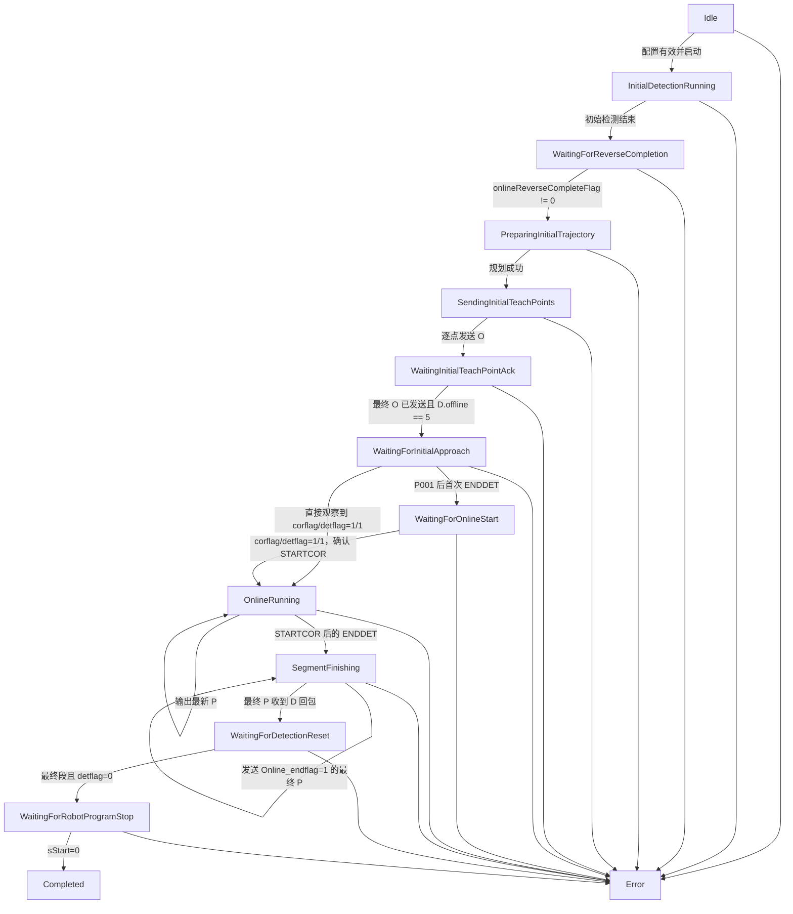
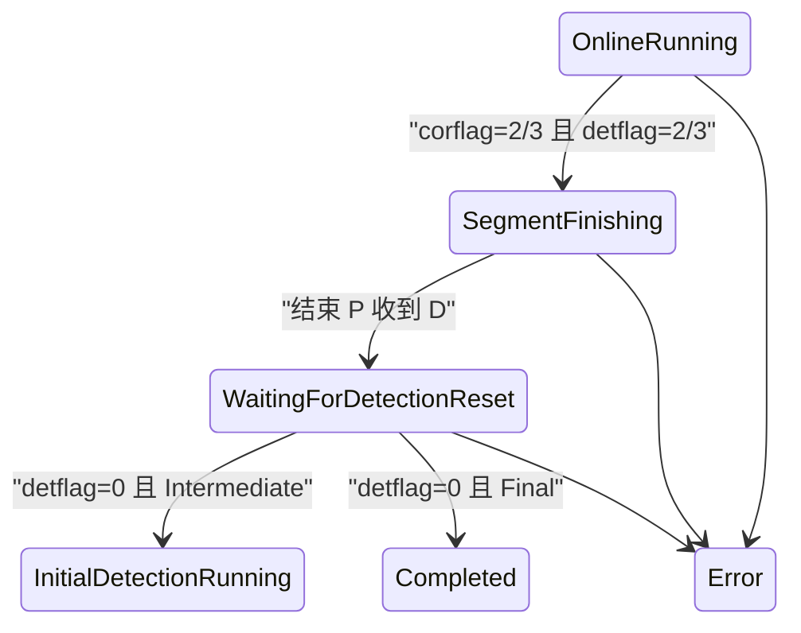

# OnlineCor 在线纠偏状态机说明

## 当前闭环

`COnlineCorrectionController` 位于 `Control`，串行消费视觉检测事件、`RobotState`
和机器人命令回执。控制器不访问 Qt、相机或 socket，只输出 O/P 命令 DTO 以及
启动、停止 Vision tracking 的请求。

启动前必须同时配置：

- `_W` 工作轨迹文件；
- `_T` 示教位姿文件；
- `RBCALIB.DAT`，且必须存在有效 `////SRANG` 六维记录。

任一配置缺失时，`startInitialDetection()` 进入 `Error`，不会启动 Vision
tracking，也不会发送 O/P 命令。RobotComm 在程序启动后独立建立真实连接并周期发送
N 状态轮询。

UI 的“在线纠偏配置”按钮按 `_W`、`_T`、`RBCALIB.DAT` 顺序选择文件。
`UiController` 在调用 `CRuntimeCoordinator::configureOnlineCorrection()` 前同步执行
轨迹和标定解析；校验未通过时，“启动焊缝跟踪”只显示错误，不向 worker 发出启动事件。



## 事件与责任边界

| 阶段 | 输入 | 输出/副作用 |
| --- | --- | --- |
| `InitialDetectionRunning` | 初始视觉样本 | 单独保存初始样本，不进入在线队列。 |
| `WaitingForReverseCompletion` | `RobotState` | 等待反向扫描完成标志。 |
| `PreparingInitialTrajectory` | 轨迹、起点模式、初始样本 | 生成修正分段和整批 O 命令 DTO。 |
| `SendingInitialTeachPoints` | RobotComm | 按原索引逐条发送 O，每条读取 D。 |
| `WaitingInitialTeachPointAck` | O 回执、`RobotState` | 最终点已发送且 `offline==5` 后，仅确认 O 点写入完成。 |
| `WaitingForInitialApproach` | `RobotState` | Vision 保持停止；等待机器人到达 P001 后的第一次 `ENDDET`。若轮询直接观察到 1/1，可安全跨过短暂 ENDDET 电平。 |
| `WaitingForOnlineStart` | `RobotState` | 等待 `corflag==1 && detflag==1`，明确确认 `STARTCOR`。 |
| `OnlineRunning` | 在线检测样本 | 启动 KCF，执行异常处理、路径跟随并生成 P；P 使用最新值覆盖。只有进入本阶段后的 ENDDET 才能结束在线段。 |
| `SegmentFinishing` | 在线段结束事件 | 立即停止 KCF，发送 `Online_endflag=1` 的最终 P；迟到视觉帧不得再生成普通 P。 |
| `WaitingForDetectionReset` | 最终 P 回执、`RobotState` | 等待 `detflag==0`；中间段加载下一段，最终段继续等待机器人主程序停止。 |
| `WaitingForRobotProgramStop` | `RobotState` | 保留纠偏会话和实际路径记录，直到 `sStart==0`；报警或保持仍进入 `Error`。 |
| `Completed` | `sStart==0` | 主程序已经停止，关闭记录并清理纠偏会话。 |

## P001、STARTCOR 与两次 ENDDET

当前实机 JBI 在 `MOVL P001` 后先调用一次 `ENDDETPRG`，随后调用 `STARTCOR`，
完成 `SMOVC` 在线运动后再调用一次 `ENDDETPRG`。两次 ENDDET 不能按相同语义处理：

1. O 回执中的 `offline==5` 只确认动态点写入控制柜，不表示机器人已到达 P001，
   也不启动在线 KCF。
2. P001 后的第一次 ENDDET 只关闭初始阶段并进入 `WaitingForOnlineStart`，不得发送
   `Online_endflag=1`。
3. 观察到 `corflag==1 && detflag==1` 后才进入 `OnlineRunning` 并启动 KCF。若 D
   轮询跳过了持续时间较短的第一次 ENDDET，但直接观察到 1/1，也允许从
   `WaitingForInitialApproach` 进入 `OnlineRunning`。
4. 只有已进入 `OnlineRunning` 后收到的 2/2 或 3/3 才表示在线段结束。
5. 第二次 ENDDET 锁存后立即停止 KCF并发送最终 P，避免迟到帧覆盖结束命令；
   运行记录持续到 `sStart==0`。这样退出运动或碰撞报警
   仍会写入 `actual_robot_path.txt`，UI 也不会在机器人仍执行时提前显示“已完成”。

当前实机 JBI 的首段时序是
`STARTDETPRG -> FINISHREVERSEDET -> MOVL P001 -> ENDDETPRG -> STARTCOR -> SMOVC`。
`ENDDETPRG` 会使 `traflag` 在 SMOVC 阶段保持 0，因此帧门禁按阶段区分：

- 初始反扫、离线纠偏和全局定位仍必须满足 `traflag==1`；
- `STARTCOR` 已确认的 `OnlineRunning` 使用状态机锁存作为跟踪授权，
  不再要求 `traflag==1`，但仍要求程序运行、PLAY、无保持且无报警；
- 检测窗口暂停时 UI 清除过期 KCF 叠加并恢复实时相机画面，
  只有新跟踪窗口真正启动时才显示“等待首个完整检测帧”。

纠偏帧的绿色点由 UI 使用同一帧的 KCF 结果绘制；等待 P001 和等待 STARTCOR
期间没有在线 KCF 点属于正常状态。进入 `OnlineRunning` 后，有效检测帧必须显示
绿色点；暂停或结束检测窗口时清除过期叠加，并恢复实时相机画面。

## 初始反向扫描与 `_W/_T` 的职责

当前 `COnlineCorrectionTrajectoryPlanner` 按以下规则生成初始 O 点批次：

1. 反扫检测的最后有效点先补回 `RBCALIB` 中的变位机工装 TCP 平移。
2. 以该点分别对齐 `_W` 当前参考段首点和 `_T` 当前示教段首点，平移整段位置；
   `GlobalCorrection` 模式会先应用全局变换。
3. `InitType` 与 `GlobalCorrection` 的首个 O 点（动态 P001）保留计算所得位置和
   `_T` 首点的目标 `S1/S2`，RobotBase 姿态取本轮反扫完成 D 回包中的当前焊枪
   `curRx_r/curRy_r/curRz_r`。后续 O 点仍保留 `_T` 模板姿态并按各自外轴转换。

规划器保留了初始路径匹配结果字段和相关阈值配置，但当前首点对齐流程不执行
最近点匹配，也不使用这些阈值拒绝初始 O 点批次。

## 在线轨迹 ICP 与布尔开关

`config/workflows/online_correction.txt` 中只需修改：

```text
enable_online_icp=true
```

- `true`：在线检测逐帧累计，满足条件后调用现有轨迹 ICP，生成本批预测轨迹。
- `false`：直接把有效检测点交给原路径跟随器，不进入 ICP 或其缓存。
- UI 配置时及每次启动前读取；修改在下一会话生效，无需重编译或重启。运行中的
  会话及其后续程序段保留启动快照。文件不存在使用默认 `true`；非法值、重复项
  或缺少配置键会阻止配置/启动并给出错误，不静默开启。
- 该开关不控制起点校正、全局/局部定位 ICP 或离线纠偏。

当前 worker 每帧只交付一个检测点，因此处理器分别保存已释放的拟合历史和未释放的
pending。检测窗口每三点抽样并补末点，抽样后至少五点；窗口及新批首尾跨度达到
2 mm，且历史存在时至少三个新点，才运行 ICP。正常等待不视为失败；窗口最多
512 点，条件持续不足时原样释放 pending。段尾显式 flush；不足求解时原样保留
尾点，再次 flush 不重放。静止或低速采样会增加等待时间，该门槛不保证固定输出周期。

参考轨迹使用与起点 O 批次相同的全局变换和首点平移，并与在线输入采用同一
变位机末节坐标约定；检测点及变化点同时补回工装 TCP 偏移。当前程序段的相邻
`_T` 点确定几何子段，边界共享端点；未知 seam（`-1`）时使用完整当前 `_W` 段，
不锁死首个几何子段。已知 seam/变化点切换时旧侧先释放、新侧重新累计。

求解方向沿用拷贝单段活动分支：检测点配准到示教模型，取逆变换移动模型。结果必须
有限、旋转合法且最近邻 RMS 不比初始值更差。仅输出 pending 首尾在变换后折线上的
精确投影及其内侧顶点；历史只拟合，不重复追加。连续模型相位只向前，限制短批搜索
弧长以避免近闭环误跨整圈；不自动绕回起点。seam、参考范围切换和 reset 清理进度。
gap 仅从本批 pending 映射。求解或截段失败时保留原始新点，不把原始回退计作应用成功。

截段两端还必须落在模型采样尺度与拟合残差允许的邻域内，避免把受限搜索边界硬接为
预测点。新变换使相位跳跃超过本批前进预算，但本批正向首尾投影仍相容时，完整保留
原始点并重定位游标，记录 `online ICP phase shift` 原因；不合成跨距轨迹。
当前参考只允许单次向前经过，达到参考尾端后继续输入会原始回退，不自动闭环重放。

`session_summary.txt` 记录 `enable_online_icp`；`realtime_correction.txt` 沿用原列布局，
以 `event=online_icp` 的 message 记录 `enabled/attempted/applied/buffered/rms_mm/reason`，
用于区分关闭、累计等待、真实求解应用和原始回退。RMS 只是匹配残差，不能作为
机器人定位精度或收敛验收证明。

### 每批 ICP 与实际跟随目标记录（2026-10-20）

新的在线纠偏会话自动在原 `output/online_correction/<会话>/` 目录增加以下
UTF-8、Tab 分隔文件，旧文件列布局保持不变：

| 文件 | 内容 |
| --- | --- |
| `online_icp_batches.txt` | 每个释放批的时间、事件编号、批次编号、程序段、开关、求解/采用/flush 标志、点数、RMS、候选 4×4 矩阵和结果说明。 |
| `online_icp_points.txt` | 通过 `batch_index` 关联的 `fit_input`（含历史的实际降采样拟合输入）、`reference_model`（当前参考模型，仅 valid 点送入求解）、`raw_pending`（本批原始新点）和 `released_target`（实际送入跟随队列的点列）。 |
| `online_follow_targets.txt` | 通过 `update_index` 关联事件，记录普通 P 计算实际使用的当前位置、目标直线的 first/direction 两点、当前及预测垂足、外轴角、`_W` 索引和最终 dx/dy/dz。 |

`batch_index` 从 1 开始，在会话内唯一，跨程序段继续递增；`update_index` 从 1
开始，每次 worker 发布状态更新时递增。一事件可能释放多个批次，逐批保留，不用
最后一批覆盖前一批。普通状态更新不重复落盘批次；等待状态仍留在旧 `online_icp`
事件中。点索引和 `_W` 索引均从 0 开始。摘要新增 `icp_diagnostics_schema=1`
及结束时的 `icp_batch_count`。

所有新增点坐标均为**变位机末节系、mm**；外轴角为 deg，P 增量为机器人基座方向
的 µm。矩阵 `m00` 至 `m33` 按行展开，采用列向量约定：
`p_model = T_detection_to_model * p_detection`。在线算法取其逆移动模型，
因此不可直接把矩阵平移项当成目标轨迹的位移。候选矩阵不代表已采用，必须同时看
`attempted/applied/message`。未求解时矩阵及 RMS 留空，不能用单位阵或 0 宣称求解
成功；`matrix_present` 只表示保存了求解器返回值，不表示矩阵有效。

`released_target` 是入队点，可能在后续事件才被使用，或被越过/方向判断移除；
**当次释放批不等于当次跟随目标批**。实际目标线以 `online_follow_targets.txt`
为准，它保存的是目标直线上的两个点及垂足，不能把 direction 字段读作单位方向向量。
没有生成普通 P（包括只发送段尾结束标志）时不伪造跟随几何。
结合现有 `actual_robot_path.txt` 和 P 发送/回包记录，可以进一步分析检测点、局部
配准目标、实际跟随目标和 TCP 高度的传播关系；记录时间是 worker 落盘时间，
不能当作相机曝光或控制柜实际执行时刻。

诊断通过值快照由 Control 传到现有 UI worker 记录器，不在求解器内执行文件 IO，
不把整批数据留在会话状态里。每次事件合并批次和点行后写入，避免逐点开关文件。
记录失败沿用现有状态提示，不改变纠偏命令的数学结果；现场仍需核查额外 IO 的
周期耗时。历史会话无法补回未记录的真实矩阵与目标线，新程序需重新生成并运行后
才会产生这些数据。

## 与视觉伺服起点的边界

`OnlineCorrectionInitialPathMatch` 当前保持无效；初始点由反扫检测终点确定。

- `InitType/GlobalCorrection`：由反扫检测终点对齐当前 `_W/_T` 段，并用反扫完成
  时的机器人反馈姿态生成动态 P001。
- `IBVSStart`：明确绕过反向扫描匹配，以视觉伺服完成后的当前机器人位置作为起点
  来源，避免再次叠加反扫残差。

当前 `IBVSStart` 只读取当前机器人位置作为起点，P001 姿态仍按 `_T` 模板生成；
完整六维视觉伺服结果的注入不属于本次修改。

匹配结果无效时，运行记录不会追加 `_W` 匹配索引、线段比例和方向置信信息。

以下是此前最近点匹配方案的历史复核，不能解释为当前规划器行为。使用
`output/online_correction/20260914_174544_959` 的 277 个初始检测样本做离线
复核：末尾 32 个样本经首尾各 4 点均值后扫描跨度约 4.671 mm，匹配到一基
`_W[163]`，投影距离约 1.626 mm，反向方向余弦约 0.996。对应局部残差约为
`(-1.350, -0.907, -0.027) mm`；旧实现相对 `_W[1]` 得到的
`(+10.019, -102.873, +0.379) mm` 不再用于整体平移。

## 旧实现映射

- `OnStartinitdet_change()`：对应初始检测、反向完成等待和初始轨迹规划。
- `OnlineTeachTrajectoryInitial()`、`correctTeachTraj()`、`correctTeachPts()`：
  对应 `COnlineCorrectionTrajectoryPlanner`。
- `OnlineExceptionHandling_beta()` 活动分支：
  对应 `COnlineCorrectionExceptionProcessor`，复用 `CIcpRegistrationMatcher`。
- `CorrectTaughtPathO()` 的 `ControlMethod==0`：
  对应 `COnlineCorrectionPathFollower`，保留 0.8 mm 越过阈值、重复点剔除、
  十点历史、方向检查、跳变量限制和可选 gap 调速。
- `RobotCtrl.cpp` 的 N/O/P 与 D 回包：
  对应 `CRobotProtocolCodec` 和 `IRobotCommandTransport`。

未迁移 `onlineFlipFlag`、HALCON、MFC Timer、调试文件和 `s_TraOrCor==0` 分支。

## 线程边界

- Vision worker：按旧名调用仿真函数并输出空间点、可选 gap、`getSeamIndex()`。
- Online worker：串行处理视觉事件、机器人状态和命令回执。
- RobotComm worker：唯一持有 transport；N 周期轮询，O 顺序发送，P 最新值覆盖。
- UI 线程：只发出用户意图并显示状态，不执行阻塞通信或纠偏计算。

## 验证要求

- 协议验证应逐字符覆盖 N/O/P，并解析完整 32 字段 D 回包。
- 状态机验证应覆盖初始检测、反向完成、O 逐点发送、`offline==5`、P001 后首次
  ENDDET、STARTCOR 1/1、OnlineRunning、第二次 ENDDET、最终 P、检测复位、
  `sStart==0` 和 Completed。
- 算法：RBCALIB 黄金平移值、变位机双向变换、仿真 seam 变化 ICP、
  重复点剔除、方向反转拒绝、跳变量限制和 gap 调速。
- runtime：默认仿真回调安全性、五个旧函数名调用顺序、P 最新值覆盖，以及
  Vision 样本到 O/P/D 回执的 fake transport 闭环。

在线 ICP 回归覆盖逐帧累积、真实内核数值结果、布尔旁路、密集新帧等待、历史不重放、
seam 两侧不足、尾 flush/reset、起点/全局参考变换和 P001/STARTCOR 门禁。
macOS clang++ 辅助验证与离线日志回放只验证算法及纯 C++ 调用链；最终仍需 Windows
Visual Studio 2022/MSVC 整体构建、测试和现场输入/机器人时序验证。

2026-10-18 的辅助回放使用 `output/online_correction/20261008_233921_455` 中
11,824 个有效在线帧、1,368 个起点校正参考点及日志记载的 TCP 偏移。实际发生
495 次求解、381 次应用、114 批原始回退（其中 21 批可靠游标重定位），尾部 pending
为 0。全部应用批次的临时相位诊断均未倒退；参考耗尽后的 85 次求解保持原始回退。
该回放没有机器人运动真值。批次释放间隔的 p50/p95/max 约为 1.22/2.62/11.68 s，
因此现场还需确认传感器前置距离和跟随队列能覆盖累计延迟，不能把该结果视为固定
周期通信、设备控制或配准精度验收。

## 多分段结束状态



`corflag/detflag` 使用边沿锁存，同一组 100 ms N/D 轮询只触发一次结束 P。
`Online_endflag` 仍只属于出站 P 协议上下文，不写入 `RobotState`。

## 2026-10-26 临时首丢诊断

诊断标记为 `[DEBUG-kcf-20261026]`；不改变检测门限、验收结论、点位选择或控制策略。
`vision_diagnostics.tsv` schema 9 在末尾追加 `debug_kcf_20261026_gates`，包含原图几何、
投影、身份相似度/次峰/双侧模板得分/位置差、母材支撑和续接资格的实际判定信息。

启用视觉诊断、图像和 `lossWindowEnabled` 时，反向初扫、正式在线各捕获一次首丢窗口：
最多前 6 个已处理曝光、触发曝光和后 8 个已处理曝光。曾经有效后首次拒绝即触发；
一直未建立有效检测时，连续 8 次拒绝触发。重复、乱序帧不冒充新增曝光；阶段切换或
会话结束可截短窗口，不补造相机未交付/算法未处理的帧。

原图在 `loss_window_images/` 后台无损保存，独立磁盘预算 64 MiB、待写队列最多 32 帧；
内存历史最多 6 帧且不超过 16 MiB，单张超过 16 MiB 不复制。原有 30 对/32 MiB 常规
采样预算不变。`loss_window_index.tsv` 记录 before/trigger/after 和提交状态，实际是否
保存必须核对 `loss_window_images/image_manifest.tsv`，不能把 queued 当作 saved。

`loss_window_context.jsonl` 保存各图对应的原始曝光 ID/时间、投影标定与冻结变换、
仿真搜索提案、证据参数和控制参考快照。控制参考明确关联到“控制线程消费本结果前”，
不是曝光时刻或 UI 绘制时刻；不得伪装成三者严格同步。仅有窗口也不能恢复更早的全部
检测器历史，离线回放应保留这个起始状态限制。关闭 `lossWindowEnabled` 可单独停用窗口。

## 焊前响应校准的阶段交接

同一纠偏会话由反扫进入正式在线时，重建曝光和位置跟踪模型，但保留同来源焊前响应统计。
Vision worker 在下一帧校验非零会话 ID、正式在线窗口和工件参考版本；不匹配即完整重置。
图像尺寸或焊缝变化也会清除保留的统计。单模板、三模板的分布仍分开校准，不能把三模板的
成熟分布套用到重初始化后的首个单模板响应；不足 30 个正常焊前样本时仍依靠原图外观校核，
不通过补造或收集异常在线样本凑足统计。

## 2026-10-27 预焊连续回放诊断

`config/workflows/online_vision_diagnostics.txt` 增加独立的 `replay_capture_enabled`、
`replay_max_frames`、`replay_max_bytes`。代码默认关闭；本轮现场诊断配置显式打开，
从初始检测起连续归档已处理曝光，不等待控制拒绝。保存真正送入process的CV_8UC1灰度
像素，不能让回放重新对彩色原图转灰。默认上限2048曝光、1GiB压缩图像，
独立后台队列最多8个待写帧，编码中另持有1帧；每帧原图最多16MiB。原有常规采样和首丢
窗口预算不变。后台编码及写入不在UI或检测线程；会话结束排空并join，不删除历史图像。

诊断策略与在线记录器使用同一份会话配置，独立于启动事务的临时配置保存。
正式启动完成清理临时事务后，反向初扫及在线阶段重新配置 Vision 仍沿用该策略；
不能回退到默认关闭连续采集，也不能把显式关闭的诊断重新打开。下一次在线配置或
正式启动以新配置替换快照。UI 结果仍裁去归档大对象，记录器消费未裁剪的独立结果。

`replay_context.jsonl`与`replay_index.tsv`按处理到达序列对应，图像在`replay_images/`。
队列满、缺图/超尺寸、帧数耗尽和磁盘预算不足必须显式留痕；queued不是saved，必须核对
`replay_images/image_manifest.tsv`。末尾不足不补造原图。帧数上限后仍保留数值上下文和
frame_limit索引，不能将截断输入宣称为完整回放。相机曝光ID不连续不等于丢处理帧。

上下文冻结真正传入检测器的仿真折线、焊点有效性、seam、同曝光参考版本及投影，
不使用UI当时的最新参考。reset/restart/gap按实际调用顺序附着在下一次process之前；
restart保留焊前统计，reset全部重置，gap只断开连续性。无法取得实际输入时
`detector_input_complete=false`，审计必须失败，不能借用其他帧的投影掩盖缺口。

`unified_session.jsonl`的observation增加trigger_accepted及paper_tracking对象，
后者记录PSR、响应模板数、正常样本数/均值/标准差、统计成熟/正常判定、训练提交/拒绝/
仿真来源和肩部/完整外观支持。训练提交不等于实拍训练。已有位置融合与原始仿真/模板
锚字段保持独立。TSV原有schema及列顺序不变。

结束会话后执行`tests/diagnostics/online_detector_replay/audit_capture.py <会话目录>`，
审计实际处理曝光覆盖、图像写入结果、PNG结构与尺寸、参考帧归属及生命周期操作。
通过后使用同目录的replay_context.jsonl作为生产DetectorReplay输入，不插值或补曝光。
完整性通过只说明输入可回放，不证明现场定位精度。合成运行时对照必须明确标注为合成，
不能把其像素一致性视为现场预焊恢复验证。

## 2026-10-28 预焊与反光后的原图恢复

三模板、HOG/灰度联合训练、Kalman位置估计和虚实融合保持原有主线。检测器另存最近
已确认接缝几何相对于同曝光仿真点的局部偏差及双侧方向；肩部相关续测不能递推移动
此参考。会话、图像尺寸、焊缝或参考版本变化，以及reset/restart/gap或仿真点缺失时
撤销它。它只生成当前原图的搜索提案，不直接提供实测点或控制资格。

局部原图精定位失败且外观不完整时，允许按该参考在当前图像中重捕获，并校核双侧
方向。提案仍进入原有身份、唯一性及多曝光确认；确认之前不训练实拍模板，不移动
搜索锚或图像运动历史，也不取得控制资格。身份确认后，允许在原图实测位置重建跟踪，
避免旧相关响应和连续显示的步长约束将已恢复的可见接缝持续留在旧点附近。

同版本、同曝光关联的参考运动超出旧身份图像块时，只有当前原图几何落在关联走廊内
才允许在新位置重验身份。该操作不续期预测预算，参考冲突仍保留；恢复必须满足原有
身份及连续曝光确认。固定参考只占分帧搜索周期的第一次尝试，之后让出精定位预算，
使扩大搜索游标继续推进，每曝光最多两次精定位的预算不变。

上述参考来自现有仿真点与已确认图像几何。本轮未新增从原始示教程序读取、按运动
进度对齐到当前激光截面并用于遮挡移动的链路；不能将其描述为示教轨迹补偿已完成。
历史实拍受控回放中的构造仿真折线、重复曝光和时序必须单独标注，像素误差不能替代
现场连续通过预焊点的验证或三维TCP精度验收。

## 2026-10-28 预焊参数离线选型

比较22组PSR、观测噪声及部分观测策略后，生产默认保持PSR双侧3sigma、Q=0.03，
二维位置观测噪声范围改为[0.0015, 0.3]像素平方。成熟PSR异常且未取得独立几何
资格时，观测噪声乘10；不改变模板更新、身份确认和空间控制资格条件。

双肩约束存在且没有局部矛盾时，部分观测保留上一可靠位置融合状态，供后续完整
观测继续融合；部分观测本身保持原有输出和估计来源，不刷新可靠虚实偏差。
缺图、无有效观测、仿真点缺失、参考版本/焊缝变化及reset/restart/gap仍撤销状态。
已确认原图恢复沿用原有大创新接纳行为，不用固定仿真绝对位置拖慢恢复。
曝光时间未知时，撤销新增的部分观测状态保留及异常降权，使用既有图像主导噪声范围；
不能假定未知的曝光间隔仍适用于本轮平滑整定，拖慢清晰接缝的重新接纳。

关闭ICP的离线程序验证了参考平移(160,-70)及(-160,70)像素的受控输入；通过已接受
图像形成的局部虚实偏差容纳摆放误差。不能将这些像素偏差等同于实际工件毫米误差。
近静态3曝光预焊入口最大步长由5.887降到3.190像素，4像素要求只用于该片段，
不是全局运动门限。完整矩阵及未通过的稀疏跳变/冷启动压力案例保存在
output/analysis/preweld_parameter_sweep_20261028/selection.json，不能只引用平滑正例。

## 2026-10-28 外围母材条纹辅助预焊估计

正式在线及初扫显式启用 `paperUseMotherBranches`；三模板、双特征、PSR 与现有
Kalman 参数保持不变。近期完整可见接缝在同帧原图外围校准左右母材线与焊点的法向
偏差，该辅助模型与独立几何锚、逐帧相关位置融合偏差分开。仅完整身份支持的原图
几何或已独立确认的几何可建立种子。双侧持续可见时保留原始可靠身份块及焊点到
母材线的法向偏差，只由当前外围像素更新线的位置；局部预焊折点和递推实拍模板
不能逐帧改写身份或法向偏差。估计点不更新可靠种子。

支撑带相对种子横坐标为左[-260,-100)、右[130,330)像素，绕开中心预焊凸起。
每曝光在上一实际支撑线附近±12像素提取窄峰，要求对比度≥40灰度、宽度≤12像素、
有效列≥60%且至少16列，排除相距≥8像素的80%等强竞争峰。稳健拟合RMS≤1像素，
相对种子方向变化≤0.12弧度，双线斜率差≥0.1；双侧均有当帧实拍支持才产生二维估计。
这些参数是本轮受控离线选型结果，不是物理精度或停机门限。

双侧支持时，当前候选和母材约束位置均须符合原始可靠接缝身份。否则，或中心
几何缺失且完整可信当前跟踪不足，或局部候选与母材约束相差超过原有8像素
不确定度且完整身份不获支持时，以当帧外围线约束替代短肩部跳峰。所有恢复候选均
使用重建前的实拍身份验收，验收后才允许重建模板。结果为 `GuidedEstimate`，不刷新独立几何锚、
不作为ICP实测、不训练实拍模板、不刷新可靠虚实偏差。完整可见接缝仍可直接恢复及
重新校准，不用固定步长缓慢追回。仿真绝对坐标不参与这一结构估计。

种子最长12秒；完整可靠几何可在到期前重新建立种子，未知或倒退时间、
reset/restart/gap、尺寸或焊缝变化均废弃。虚拟工件参考版本变化仍清除仿真相关的
几何偏差及位置融合先验，但不移动真实像素模型；该模型仍须逐曝光获得当前双侧
支撑才可输出，不能把旧线当当前观测。双侧支撑不足时交回既有跟踪/恢复逻辑。
扩大搜索尚未结束时交替留出局部几何校核机会，仍受每曝光最多两次精定位预算
约束；已验收的完整几何结束残留搜索周期，以便清晰恢复和长期重新建立种子。
控制资格仍受有效投影与已有门禁约束；真实失测的停止策略未在本轮改变。

工件在线 ICP 的真实母材表面采样使用非诊断字段
`localizationEvidence.imageConstrainedEstimate` 区分当前接缝来源。受图像约束估计时，
排除检测中心左100、右130像素内的真实像素，沿用外围支撑带的中央边界；完整
观测保持原有左右24像素。采样与写后表面验证均传递该标志，不依赖诊断开关。
估计接缝仅确定排除中心，不作为独立实测焊点；外围像素仍须满足原有原图支撑
及空间质量门禁。记录左右实际边界及估计标志；旧半宽字段表示两侧最大包络。
此策略只保证规定中央区域不进入真实母材云，不代表所有预焊或反光均已语义
识别正确，也不代表工件位姿或 TCP 精度通过验收。

`unified_session.jsonl`记录母材支持、校准、估计使用及位置；回放上下文新增完整
`paper_options`冻结实际数值和开关。旧上下文缺该开关时，回放保持关闭以重现旧策略。
PNG归档改用Qt压缩量20（Qt6.7映射zlib等级1），仍无损，降低真实噪声图的后台编码耗时；
队列、总字节与帧数预算不变，仍须审计saved及预算耗尽，不能保证任意采样率永不丢图。
