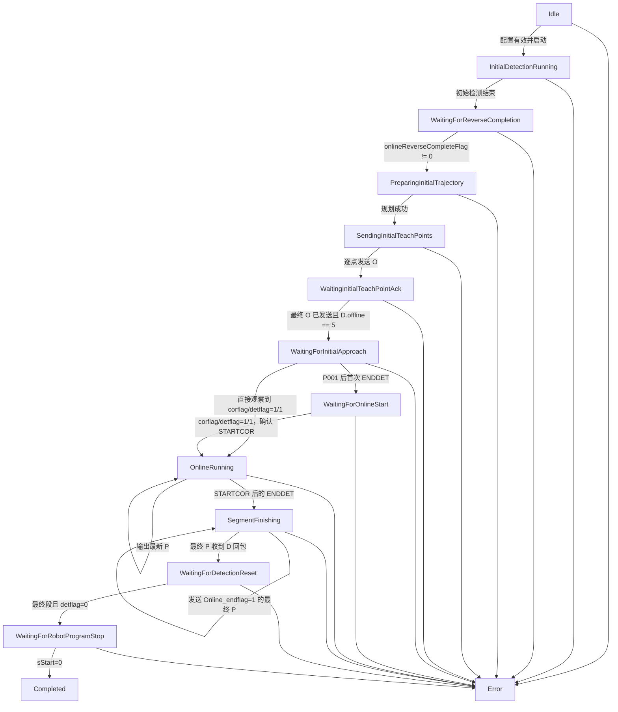
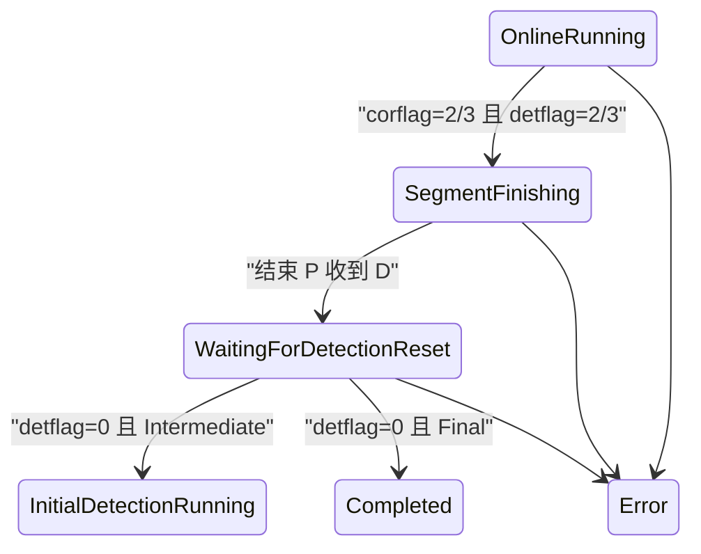

# OnlineCor 在线纠偏状态机说明

## 当前闭环

`COnlineCorrectionController` 位于 `Control`，串行消费视觉检测事件、`RobotState`
和机器人命令回执。控制器不访问 Qt、相机或 socket，只输出 O/P 命令 DTO 以及
启动、停止 Vision tracking 的请求。

启动前必须同时配置：

- `_W` 工作轨迹文件；
- `_T` 示教位姿文件；
- `RBCALIB.DAT`，且必须存在有效 `////SRANG` 六维记录。

任一配置缺失时，`startInitialDetection()` 进入 `Error`，不会启动 Vision
tracking，也不会发送 O/P 命令。RobotComm 在程序启动后独立建立真实连接并周期发送
N 状态轮询。

UI 的“在线纠偏配置”按钮按 `_W`、`_T`、`RBCALIB.DAT` 顺序选择文件。
`UiController` 在调用 `CRuntimeCoordinator::configureOnlineCorrection()` 前同步执行
轨迹和标定解析；校验未通过时，“启动焊缝跟踪”只显示错误，不向 worker 发出启动事件。

## 事件与责任边界

| 阶段 | 输入 | 输出/副作用 |
| --- | --- | --- |
| `InitialDetectionRunning` | 初始视觉样本 | 单独保存初始样本，不进入在线队列。 |
| `WaitingForReverseCompletion` | `RobotState` | 等待反向扫描完成标志。 |
| `PreparingInitialTrajectory` | 轨迹、起点模式、初始样本 | 生成修正分段和整批 O 命令 DTO。 |
| `SendingInitialTeachPoints` | RobotComm | 按原索引逐条发送 O，每条读取 D。 |
| `WaitingInitialTeachPointAck` | O 回执、`RobotState` | 最终点已发送且 `offline==5` 后，仅确认 O 点写入完成。 |
| `WaitingForInitialApproach` | `RobotState` | Vision 保持停止；等待机器人到达 P001 后的第一次 `ENDDET`。若轮询直接观察到 1/1，可安全跨过短暂 ENDDET 电平。 |
| `WaitingForOnlineStart` | `RobotState` | 等待 `corflag==1 && detflag==1`，明确确认 `STARTCOR`。 |
| `OnlineRunning` | 在线检测样本 | 启动 KCF，执行异常处理、路径跟随并生成 P；P 使用最新值覆盖。只有进入本阶段后的 ENDDET 才能结束在线段。 |
| `SegmentFinishing` | 在线段结束事件 | 立即停止 KCF，发送 `Online_endflag=1` 的最终 P；迟到视觉帧不得再生成普通 P。 |
| `WaitingForDetectionReset` | 最终 P 回执、`RobotState` | 等待 `detflag==0`；中间段加载下一段，最终段继续等待机器人主程序停止。 |
| `WaitingForRobotProgramStop` | `RobotState` | 保留纠偏会话和实际路径记录，直到 `sStart==0`；报警或保持仍进入 `Error`。 |
| `Completed` | `sStart==0` | 主程序已经停止，关闭记录并清理纠偏会话。 |

## P001、STARTCOR 与两次 ENDDET

当前实机 JBI 在 `MOVL P001` 后先调用一次 `ENDDETPRG`，随后调用 `STARTCOR`，
完成 `SMOVC` 在线运动后再调用一次 `ENDDETPRG`。两次 ENDDET 不能按相同语义处理：

1. O 回执中的 `offline==5` 只确认动态点写入控制柜，不表示机器人已到达 P001，
   也不启动在线 KCF。
2. P001 后的第一次 ENDDET 只关闭初始阶段并进入 `WaitingForOnlineStart`，不得发送
   `Online_endflag=1`。
3. 观察到 `corflag==1 && detflag==1` 后才进入 `OnlineRunning` 并启动 KCF。若 D
   轮询跳过了持续时间较短的第一次 ENDDET，但直接观察到 1/1，也允许从
   `WaitingForInitialApproach` 进入 `OnlineRunning`。
4. 只有已进入 `OnlineRunning` 后收到的 2/2 或 3/3 才表示在线段结束。
5. 第二次 ENDDET 锁存后立即停止 KCF并发送最终 P，避免迟到帧覆盖结束命令；
   运行记录持续到 `sStart==0`。这样退出运动或碰撞报警
   仍会写入 `actual_robot_path.txt`，UI 也不会在机器人仍执行时提前显示“已完成”。

当前实机 JBI 的首段时序是
`STARTDETPRG -> FINISHREVERSEDET -> MOVL P001 -> ENDDETPRG -> STARTCOR -> SMOVC`。
`ENDDETPRG` 会使 `traflag` 在 SMOVC 阶段保持 0，因此帧门禁按阶段区分：

- 初始反扫、离线纠偏和全局定位仍必须满足 `traflag==1`；
- `STARTCOR` 已确认的 `OnlineRunning` 使用状态机锁存作为跟踪授权，
  不再要求 `traflag==1`，但仍要求程序运行、PLAY、无保持且无报警；
- 检测窗口暂停时 UI 清除过期 KCF 叠加并恢复实时相机画面，
  只有新跟踪窗口真正启动时才显示“等待首个完整检测帧”。

纠偏帧的绿色点由 UI 使用同一帧的 KCF 结果绘制；等待 P001 和等待 STARTCOR
期间没有在线 KCF 点属于正常状态。进入 `OnlineRunning` 后，有效检测帧必须显示
绿色点；暂停或结束检测窗口时清除过期叠加，并恢复实时相机画面。

## 初始反向扫描与 `_W/_T` 的职责

当前 `COnlineCorrectionTrajectoryPlanner` 按以下规则生成初始 O 点批次：

1. 反扫检测的最后有效点先补回 `RBCALIB` 中的变位机工装 TCP 平移。
2. 以该点分别对齐 `_W` 当前参考段首点和 `_T` 当前示教段首点，平移整段位置；
   `GlobalCorrection` 模式会先应用全局变换。
3. `InitType` 与 `GlobalCorrection` 的首个 O 点（动态 P001）保留计算所得位置和
   `_T` 首点的目标 `S1/S2`，RobotBase 姿态取本轮反扫完成 D 回包中的当前焊枪
   `curRx_r/curRy_r/curRz_r`。后续 O 点仍保留 `_T` 模板姿态并按各自外轴转换。

规划器保留了初始路径匹配结果字段和相关阈值配置，但当前首点对齐流程不执行
最近点匹配，也不使用这些阈值拒绝初始 O 点批次。

## 与视觉伺服起点的边界

`OnlineCorrectionInitialPathMatch` 当前保持无效；初始点由反扫检测终点确定。

- `InitType/GlobalCorrection`：由反扫检测终点对齐当前 `_W/_T` 段，并用反扫完成
  时的机器人反馈姿态生成动态 P001。
- `IBVSStart`：明确绕过反向扫描匹配，以视觉伺服完成后的当前机器人位置作为起点
  来源，避免再次叠加反扫残差。

当前 `IBVSStart` 只读取当前机器人位置作为起点，P001 姿态仍按 `_T` 模板生成；
完整六维视觉伺服结果的注入不属于本次修改。

匹配结果无效时，运行记录不会追加 `_W` 匹配索引、线段比例和方向置信信息。

以下是此前最近点匹配方案的历史复核，不能解释为当前规划器行为。使用
`output/online_correction/20260914_174544_959` 的 277 个初始检测样本做离线
复核：末尾 32 个样本经首尾各 4 点均值后扫描跨度约 4.671 mm，匹配到一基
`_W[163]`，投影距离约 1.626 mm，反向方向余弦约 0.996。对应局部残差约为
`(-1.350, -0.907, -0.027) mm`；旧实现相对 `_W[1]` 得到的
`(+10.019, -102.873, +0.379) mm` 不再用于整体平移。

## 旧实现映射

- `OnStartinitdet_change()`：对应初始检测、反向完成等待和初始轨迹规划。
- `OnlineTeachTrajectoryInitial()`、`correctTeachTraj()`、`correctTeachPts()`：
  对应 `COnlineCorrectionTrajectoryPlanner`。
- `OnlineExceptionHandling_beta()` 活动分支：
  对应 `COnlineCorrectionExceptionProcessor`，复用 `CIcpRegistrationMatcher`。
- `CorrectTaughtPathO()` 的 `ControlMethod==0`：
  对应 `COnlineCorrectionPathFollower`，保留 0.8 mm 越过阈值、重复点剔除、
  十点历史、方向检查、跳变量限制和可选 gap 调速。
- `RobotCtrl.cpp` 的 N/O/P 与 D 回包：
  对应 `CRobotProtocolCodec` 和 `IRobotCommandTransport`。

未迁移 `onlineFlipFlag`、HALCON、MFC Timer、调试文件和 `s_TraOrCor==0` 分支。

## 线程边界

- Vision worker：按旧名调用仿真函数并输出空间点、可选 gap、`getSeamIndex()`。
- Online worker：串行处理视觉事件、机器人状态和命令回执。
- RobotComm worker：唯一持有 transport；N 周期轮询，O 顺序发送，P 最新值覆盖。
- UI 线程：只发出用户意图并显示状态，不执行阻塞通信或纠偏计算。

## 验证要求

- 协议验证应逐字符覆盖 N/O/P，并解析完整 32 字段 D 回包。
- 状态机验证应覆盖初始检测、反向完成、O 逐点发送、`offline==5`、P001 后首次
  ENDDET、STARTCOR 1/1、OnlineRunning、第二次 ENDDET、最终 P、检测复位、
  `sStart==0` 和 Completed。
- 算法：RBCALIB 黄金平移值、变位机双向变换、仿真 seam 变化 ICP、
  重复点剔除、方向反转拒绝、跳变量限制和 gap 调速。
- runtime：默认仿真回调安全性、五个旧函数名调用顺序、P 最新值覆盖，以及
  Vision 样本到 O/P/D 回执的 fake transport 闭环。

本轮修正按实机问题范围未修改 `tests/`。下一次维护自动测试时，需要把仍假设
`offline==5` 直接进入 `OnlineRunning` 的旧断言更新为上述门禁顺序。
## 多分段结束状态

`corflag/detflag` 使用边沿锁存，同一组 100 ms N/D 轮询只触发一次结束 P。
`Online_endflag` 仍只属于出站 P 协议上下文，不写入 `RobotState`。
