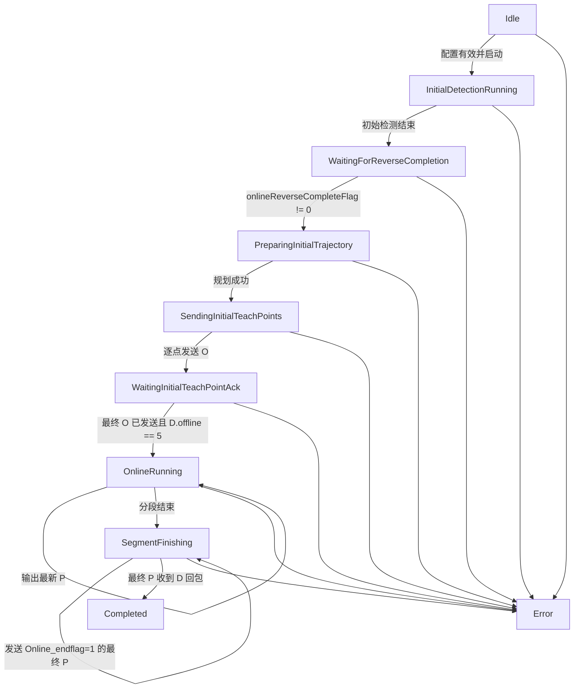
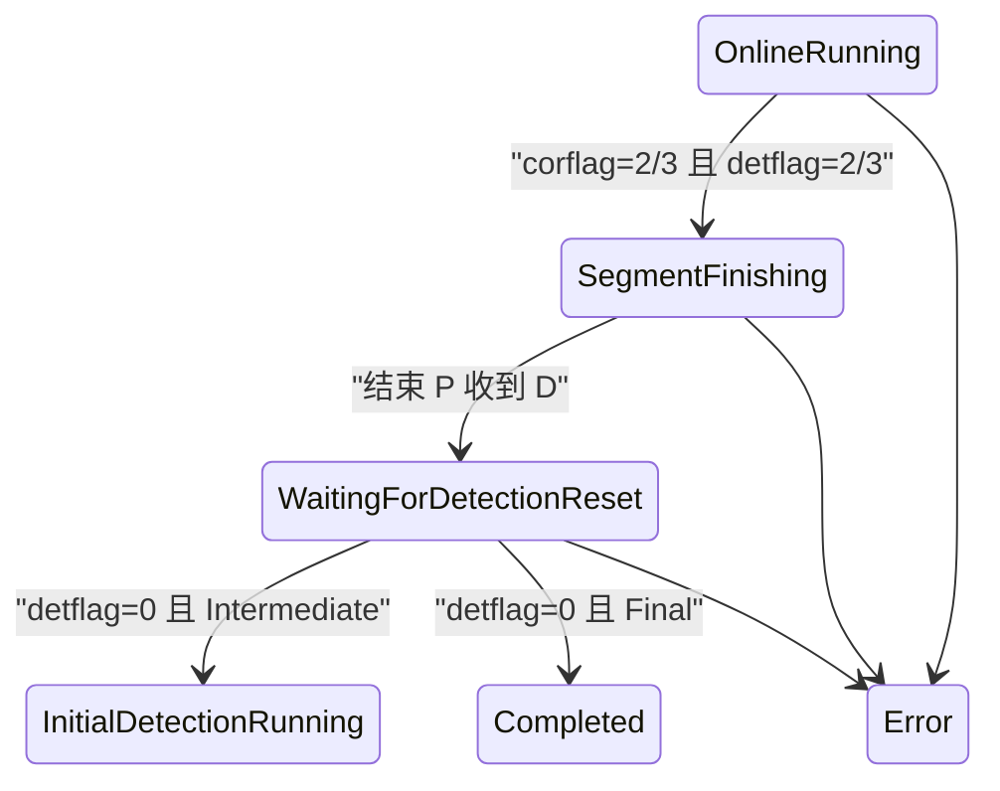

# OnlineCor 在线纠偏状态机说明

## 当前闭环

`COnlineCorrectionController` 位于 `Control`，串行消费视觉检测事件、`RobotState`
和机器人命令回执。控制器不访问 Qt、相机或 socket，只输出 O/P 命令 DTO 以及
启动、停止 Vision tracking 的请求。

启动前必须同时配置：

- `_W` 工作轨迹文件；
- `_T` 示教位姿文件；
- `RBCALIB.DAT`，且必须存在有效 `////SRANG` 六维记录。

任一配置缺失时，`startInitialDetection()` 进入 `Error`，不会启动 Vision
tracking，也不会发送 O/P 命令。RobotComm 在程序启动后独立建立真实连接并周期发送
N 状态轮询。

UI 的“在线纠偏配置”按钮按 `_W`、`_T`、`RBCALIB.DAT` 顺序选择文件。
`UiController` 在调用 `CRuntimeCoordinator::configureOnlineCorrection()` 前同步执行
轨迹和标定解析；校验未通过时，“启动焊缝跟踪”只显示错误，不向 worker 发出启动事件。

## 事件与责任边界

| 阶段 | 输入 | 输出/副作用 |
| --- | --- | --- |
| `InitialDetectionRunning` | 初始视觉样本 | 单独保存初始样本，不进入在线队列。 |
| `WaitingForReverseCompletion` | `RobotState` | 等待反向扫描完成标志。 |
| `PreparingInitialTrajectory` | 轨迹、起点模式、初始样本 | 生成修正分段和整批 O 命令 DTO。 |
| `SendingInitialTeachPoints` | RobotComm | 按原索引逐条发送 O，每条读取 D。 |
| `WaitingInitialTeachPointAck` | O 回执、`RobotState` | 只有最终点已发送且 `offline==5` 才进入在线阶段。 |
| `OnlineRunning` | 在线检测样本 | 异常处理、路径跟随、生成 P；P 使用最新值覆盖。 |
| `SegmentFinishing` | 分段结束事件 | 发送 `Online_endflag=1` 的最终 P，等待 D 回包。 |
| `Completed` | 最终 P 回执 | 停止 Vision tracking。 |

## 旧实现映射

- `OnStartinitdet_change()`：对应初始检测、反向完成等待和初始轨迹规划。
- `OnlineTeachTrajectoryInitial()`、`correctTeachTraj()`、`correctTeachPts()`：
  对应 `COnlineCorrectionTrajectoryPlanner`。
- `OnlineExceptionHandling_beta()` 活动分支：
  对应 `COnlineCorrectionExceptionProcessor`，复用 `CIcpRegistrationMatcher`。
- `CorrectTaughtPathO()` 的 `ControlMethod==0`：
  对应 `COnlineCorrectionPathFollower`，保留 0.8 mm 越过阈值、重复点剔除、
  十点历史、方向检查、跳变量限制和可选 gap 调速。
- `RobotCtrl.cpp` 的 N/O/P 与 D 回包：
  对应 `CRobotProtocolCodec` 和 `IRobotCommandTransport`。

未迁移 `onlineFlipFlag`、HALCON、MFC Timer、调试文件和 `s_TraOrCor==0` 分支。

## 线程边界

- Vision worker：按旧名调用仿真函数并输出空间点、可选 gap、`getSeamIndex()`。
- Online worker：串行处理视觉事件、机器人状态和命令回执。
- RobotComm worker：唯一持有 transport；N 周期轮询，O 顺序发送，P 最新值覆盖。
- UI 线程：只发出用户意图并显示状态，不执行阻塞通信或纠偏计算。

## 自动验证覆盖

- 协议：逐字符验证 N/O/P，并解析完整 32 字段 D 回包。
- 状态机：初始检测、反向完成、O 逐点发送、`offline==5`、OnlineRunning、
  P 输出、最终 P 和 Completed。
- 算法：RBCALIB 黄金平移值、变位机双向变换、仿真 seam 变化 ICP、
  重复点剔除、方向反转拒绝、跳变量限制和 gap 调速。
- runtime：默认仿真回调安全性、五个旧函数名调用顺序、P 最新值覆盖，以及
  Vision 样本到 O/P/D 回执的 fake transport 闭环。
## 多分段结束状态

`corflag/detflag` 使用边沿锁存，同一组 100 ms N/D 轮询只触发一次结束 P。
`Online_endflag` 仍只属于出站 P 协议上下文，不写入 `RobotState`。
