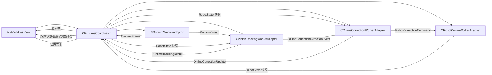

# OpencvThread 线程拆分与在线跟踪纠偏设计

## 目标

旧工程 `OpencvThread` 同时承担相机采集、图像显示、焊缝跟踪、机器人状态判断和在线纠偏触发。新工程不迁移这个大线程，而是把它拆成可独立测试的事件流：

- `CameraWorkerAdapter`：相机帧入口，负责把 `CameraFrame` 送入 UI 和视觉线程。
- `RobotCommWorkerAdapter`：机器人状态入口和命令串行出口。
- `VisionTrackingWorkerAdapter`：只执行视觉检测，本轮仅支持旧 `det_type == 2` 的仿真辅助 Gabor + KCF/MKCF 链路。
- `OnlineCorrectionWorkerAdapter`：持有 `COnlineCorrectionController`，消费视觉检测样本并推进在线纠偏状态机。
- `CRuntimeCoordinator`：Qt 运行时编排器，负责线程生命周期、queued signal/slot 连接和 UI 显示 DTO 转发。

`Control` 仍保持纯 C++；Qt worker adapter 放在 `UI`，作为 UI/线程边界适配层。

## 旧触发条件映射

旧工程中检测触发条件为：

```cpp
testStart != 1 &&
traflag == 1 &&
sMode == 2 &&
sHold == 0 &&
sStart == 1 &&
(virtualStatus == VS_ONLINE_REC_MOD || virtualStatus == VS_ONLINE_REC)
```

新工程由 `CTrackingTriggerPolicy` 承接，输入为 `TrackingTriggerInput`，输出 `TrackingTriggerDecision`。该判断不读取全局变量，只消费显式快照。

## 事件流



## Vision det_type==2 链路

`CVisionTrackingWorkerAdapter` 第一版只支持旧 `det_type == 2`：

1. 通过 `SimulatedVisionCallbacks` 获取仿真焊缝点和仿真激光线。
2. 使用仿真焊缝点生成 `250 x 200` ROI。
3. 使用仿真激光线生成 KCF 初始化模板。
4. 对真实 ROI 运行 `CImageDenoise::gaborDenoise()`，再 Otsu 二值化。
5. 按旧流程将增强 ROI 上移 5 pixel 写回 update 图。
6. 使用 `CKcfTracker` 执行 KCF / 2TMKCF / 3TMKCF。
7. 将 ROI 中心作为图像焊缝点，调用 `CWeldImageToSpaceProjector` 投影为空间点。
8. 输出 `RuntimeTrackingResult` 和 `OnlineCorrectionDetectionSample`。

其他检测类型暂不接入线程链路，返回明确 unsupported 状态。

## 仿真回调边界

`SimulatedVisionCallbacks` 保留旧方法名：

- `generate_simu_laser1`
- `getSeamPoint2d`
- `getSeamIndex`
- `toNextWeldSeam`
- `getCurrentVirtualLine`

默认实现均为空或无效返回。这样在 DigitalTwin 尚未接入时，线程链可以启动并给出可诊断失败原因，而不会崩溃。

## 同步策略

- 相机帧采用“最新帧槽”思想。当前 adapter 直接转发，后续真实相机接入时可在 `CameraWorkerAdapter` 内丢弃旧帧，避免视觉线程积压。
- `CRuntimeCoordinator` 持有最新 `RobotState` 快照。发布相机帧前，会先把最新机器人状态同步到 vision 线程，避免机器人状态和相机帧走不同线程队列导致触发判断使用旧状态。
- `OnlineCorrectionWorkerAdapter` 单线程串行推进 `COnlineCorrectionController`，UI 和 Vision 不直接跨线程调用控制器对象。
- 机器人命令统一进入 `RobotCommWorkerAdapter`，第一版 dry-run 记录命令，不直接操作 socket。
- UI 只接收显示 DTO 和日志，不直接运行检测、通信或纠偏计算。

## 当前边界

- 第一版只打通事件流，不迁 `OnlineExceptionHandling_beta`、`CorrectTaughtPath` 的完整在线纠偏算法。
- 第一版相机 worker 是适配壳，真实相机连接仍由 Camera 模块后续接入。
- 第一版机器人 worker 是 dry-run 适配壳，真实发送协议由 RobotComm 后续接入。
- `Control` 不引入 Qt；所有 `QThread/QObject/QImage` 边界都留在 `UI`。
