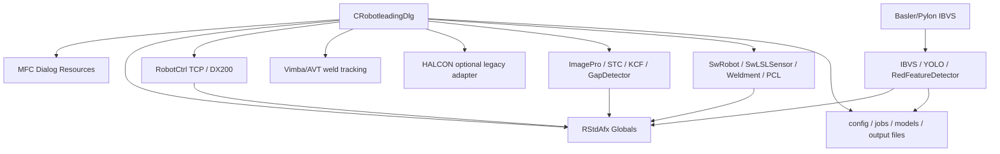

# CRobotleadingDlg 依赖图

## 策略说明

| 策略 | 含义 |
| --- | --- |
| directly reusable | 构建依赖可用后，大概率可以少量修改或不修改直接复用。 |
| reusable after adaptation | 存在有价值逻辑，但需要清理接口、接入 Qt、隔离依赖或调整数据模型。 |
| rewrite | 当前设计绑定 MFC、全局状态或 raw thread，应替换。 |
| obsolete | 独立 Qt 应用不再需要该 legacy 项。 |
| unknown | 仍需进一步确认设备、部署或行为细节。 |

## UI 与子 Dialog

| 依赖 | Legacy 文件/路径 | 角色 | 迁移策略 | 说明 |
| --- | --- | --- | --- | --- |
| `CRobotleadingDlg` | `SWv1/robotleadingDlg.h`, `SWv1/robotleadingDlg.cpp` | Combined UI, coordinator, device owner, algorithm caller | rewrite | Preserve behavior, not class shape. |
| `IDD_ROBOTLEADING_DIALOG` | `SWv1/SWv1.rc`, `SWv1/resource.h` | MFC dialog layout and control IDs | reusable after adaptation | Use as UI inventory only; design Qt widgets independently. |
| `CCalibration` | `SWv1/Calibration.h/.cpp` | Calibration child workflow | reusable after adaptation | Extract calibration model and file IO; replace MFC dialog. |
| `COffLineCor` | `SWv1/OffLineCor.h/.cpp` | Offline correction, matching, teach-point update | reusable after adaptation | Algorithm pieces may be reusable; UI and globals should be rewritten. |
| `COnlineCor` | `SWv1/OnlineCor.h/.cpp` | Online correction configuration and workflow | reusable after adaptation | Needs separation into settings model and correction service. |
| `CSetNewfile` | `SWv1/SetNewfile.h/.cpp` | New workpiece/file save workflow | reusable after adaptation | Replace with config repository and Qt dialog/widget. |
| `CHelp`, `CWMPPlayer4` | `Robotleading/robotleading_method/Help.*`, `SWv1/wmpplayer4.*` | Help/player UI | obsolete | Help text can become documentation; media player is not central unless confirmed later. |
| `CMainFrame::RobotleadingDlg` | `SWv1/MainFrm.h`, `SWv1/MainFrm.cpp` | Parent/owner and message forwarder | obsolete | Standalone app should not depend on the old MDI frame. |

## 相机接口

| 依赖 | Legacy 文件/路径 | 已确认角色 | 迁移策略 | 新目标 |
| --- | --- | --- | --- | --- |
| Vimba/AVT `ApiController` | `Robotleading/robotleading_method/Vimba_SDK/*`, `SWv1/robotleadingDlg.cpp` | Main weld tracking camera and digital-twin line-structured-light image source. | reusable after adaptation | `VimbaTrackingCameraBackend` behind `ICameraDevice`; first real camera backend after skeleton. |
| Basler/Pylon | `SWv1/PicCapture.cpp`, `SWv1/PicCapture.h`, `SWv1/baslercam.*` | External camera for IBVS. | reusable after adaptation | `BaslerIbvsCameraBackend`; full integration deferred with IBVS. |
| HALCON framegrabber | `SWv1/robotleadingDlg.cpp`, `Robotleading/robotleading_method/RStdAfx.h` | Non-priority legacy acquisition path. Only keep if a specific legacy algorithm or data format requires HALCON. | unknown / optional | `HalconCameraBackend` optional legacy adapter, default disabled. |
| Offline image source | New design, legacy images/logs as fixtures | Early development and replay testing. | rewrite | `OfflineImageCameraBackend`. |
| `cv_image`, `cv_imageEx`, `TempImg` globals | `RStdAfx.h/.cpp`, `robotleadingDlg.cpp`, `PicCapture.cpp` | Shared frame buffers | rewrite | Immutable `Frame` messages or reference-counted frame objects. |
| `OnFrameReady` / `WM_FRAME_READY` | `SWv1/MainFrm.cpp`, `SWv1/robotleadingDlg.cpp` | MFC frame notification path | rewrite | Qt queued signals from `CameraWorker`. |

新项目优先使用 OpenCV 作为图像处理依赖。除非确实需要边界很窄的兼容 adapter，否则不应引入 HALCON。

## 机器人通信

| 依赖 | Legacy 文件/路径 | 角色 | 迁移策略 | 说明 |
| --- | --- | --- | --- | --- |
| `RobotCtrl` | `Robotleading/robotleading_method/RobotCtrl.h/.cpp` | TCP client and robot protocol parser for Yaskawa DX200-related communication | rewrite | It inherits `CButton` and mutates globals; protocol knowledge should move to `RobotComm`. |
| Winsock TCP endpoint | `RobotCtrl.cpp` | Legacy endpoint such as `192.168.255.1:11000` | reusable after adaptation | Endpoint must become configuration. |
| Protocol message formats | `RobotCtrl::RevRobotData()` | Sends `P`, `O`, `S`, `C`, `J`, `N`; receives `D` state | reusable after adaptation | Extract `ProtocolParser`/`ProtocolSerializer`; field semantics still pending. |
| Robot state globals | `RStdAfx.h/.cpp` | `sMode`, `sStart`, `traflag`, `curx`, `cury`, etc. | rewrite | Replace with `RobotState` snapshots emitted by worker. |
| Multimedia TCP timer | `robotleadingDlg.cpp` | Calls `RevRobotData()` periodically | rewrite | Use worker event loop and `QTimer`/socket readiness. |
| Safety client split | New design | Keep live DX200 disabled by default | rewrite | Provide `DX200RobotClient`, `RobotComm dry-run`, and `RobotComm dry-run`; real command sending requires explicit authorization. |

## 图像处理算法

| 依赖 | Legacy 文件/路径 | 角色 | 迁移策略 | 说明 |
| --- | --- | --- | --- | --- |
| `CalthelaserpositionLoop` | `SWv1/robotleadingDlg.cpp` | Main online weld detection/correction loop | reusable after adaptation | Must be decomposed into pure vision, conversion, and correction stages. |
| `getDetImagePoint` | `SWv1/robotleadingDlg.cpp` | Gets weld point from current image | reusable after adaptation | Depends on many globals; extract input/output contract first. |
| `ConvertImgPt2SP` | `SWv1/robotleadingDlg.cpp` | Converts image point to 3D space point | reusable after adaptation | Needs explicit `SensorCalibrationData` and pose input. |
| `ImageProFeng` | `Robotleading/robotleading_method/ImageProFeng.*` | HALCON/template/laser matching algorithms | reusable after adaptation | Prefer OpenCV replacements; if HALCON is necessary, isolate the adapter. |
| `ImageProShare` | `Robotleading/robotleading_method/ImageProShare.*` | Shared line/ransac/skeleton helpers | reusable after adaptation | Candidate for pure C++/OpenCV module. |
| `Adaptive_correlation_filter`, `STC`, `kcftracker` | `Robotleading/robotleading_method/*` | Tracking and correlation methods | reusable after adaptation | Keep algorithm code isolated from UI and process globals. |
| `GaborFilter` | `SWv1/ImageDenoise.h/.cpp` | Laser line preprocessing | reusable after adaptation | Good candidate for `vision` module. |
| `GapDetector` | `SWv1/GapDetector.h/.cpp` | Weld gap detection | reusable after adaptation | Replace raw pointer ownership and pass explicit params. |
| `Filter_Kalman` | `Robotleading/robotleading_method/Filter_Kalman.*` | Filtering | reusable after adaptation | Confirm numerical behavior with sample data. |

## IBVS

| 依赖 | Legacy 文件/路径 | 角色 | 迁移策略 | 说明 |
| --- | --- | --- | --- | --- |
| `IBVS` | `SWv1/IBVS.h/.cpp` | Visual servo solver, constraints, control velocity | reusable after adaptation | First release is interface/mock/no-op only; real solver later. |
| `PicCapture` | `SWv1/PicCapture.cpp` | Basler capture plus IBVS control loop | rewrite | Split into `BaslerIbvsCameraBackend`, `IbvsService`, feature detection, and logging. |
| `YoloDetector` | `SWv1/YoloDetector.h/.cpp` | Workpiece/torch detection | reusable after adaptation | ONNX runtime dependency must be isolated; not in minimal skeleton. |
| `RedFeatureDetector` | `SWv1/RedFeatureDetector.h/.cpp` | Red feature point extraction | reusable after adaptation | Candidate for pure OpenCV tests later. |
| `InitPointDetector` | `SWv1/InitPointDetector.h/.cpp` | Start point and workpiece alignment | reusable after adaptation | Needs configuration-driven model paths. |
| `HandEyeCalibration` | `SWv1/HandEyeCalibration.h/.cpp` | Loads calibration transform | reusable after adaptation | Move file loading to config/ui support. |
| LVS globals | `robotleadingDlg.cpp`, `RStdAfx.h/.cpp`, `PicCapture.cpp` | `g_seamPoint_world`, `g_lvs_data_valid`, critical sections | rewrite | Use typed signal data and thread-safe state service. |

## 数字孪生 / 仿真

| 依赖 | Legacy 文件/路径 | 角色 | 迁移策略 | 说明 |
| --- | --- | --- | --- | --- |
| `SwBasicRobot`, `SwRobot` | `SwBase/*`, `SWv1/robotleadingDlg.cpp` | Virtual robot and positioner state | reusable after adaptation | First release is interface/mock/no-op only. |
| `SwLSLSensor` | `SwBase/*`, `SWv1/robotleadingDlg.cpp` | Simulated line laser sensor | reusable after adaptation | API can be represented by `DigitalTwinService`; real sensor simulation later. |
| `Weldment` | `SWv1/Weldment.h/.cpp` | Workpiece model and weld features | reusable after adaptation | Depends on OpenCascade and project model conventions. |
| OpenCascade/VTK/PCL | project props and includes | 几何显示、点云、ICP | reusable after adaptation | 不引入最小骨架；焊缝跟踪稳定后再集成。 |
| `g_IC` viewer/context | Larger MFC/CAD app | Scene display/update | rewrite or unknown | Standalone Qt app needs a new visualization boundary. |
| `virtualSceneThreadFunc` | `SWv1/robotleadingDlg.cpp` | Continuous simulation/workflow loop | rewrite | Convert later to worker with explicit state machine and stop token. |

## 配置文件

| 依赖 | Legacy 文件/路径 | 角色 | 迁移策略 | 说明 |
| --- | --- | --- | --- | --- |
| `data/Robotleadingdata/BASIC/SENSORPARA.txt` | Runtime data | Legacy sensor calibration file | reusable after adaptation | Must be compatible. Map to `SensorCalibrationData` or `CalibrationData` with explicit units such as m, deg, and pixel. |
| `data/Robotleadingdata/StationPos/RBCALIB.DAT` | Runtime data | Positioner calibration | reusable after adaptation | Convert parser to config repository later. |
| `models/weldment/*.weldment` | Runtime models | Workpiece definitions | reusable after adaptation | File list must be user-configurable. |
| JBI name lists | Hard-coded in `OnInitDialog()` | Robot job selection | rewrite | Move to job/workpiece config. |
| `data/IBVS/*` | Runtime data | hand-eye calibration, ONNX models, desired images, logs | reusable after adaptation | IBVS input assets are separated from output logs; first release only documents paths and interfaces. |
| `output/*` | Runtime output | point clouds, pose traces, debug images | rewrite | Use configurable output root and structured logging. |

## 线程与定时器

| 依赖 | Legacy 文件/路径 | 角色 | 迁移策略 | 说明 |
| --- | --- | --- | --- | --- |
| MFC `SetTimer(0/1)` | `robotleadingDlg.cpp` | UI status refresh | rewrite | Use UI-owned `QTimer` only for display polling if needed. |
| `timeSetEvent` / `TCPTimerProc` | `robotleadingDlg.cpp` | Periodic robot TCP exchange | rewrite | Use worker event loop and `QTimer`/socket notifier; dry-run/mock by default. |
| `SnapThread` | `robotleadingDlg.cpp` | HALCON acquisition | rewrite | Optional HALCON adapter only; not default. |
| `OpencvThread` | `robotleadingDlg.cpp` | Vimba frame processing/display loop | rewrite | No worker should draw UI or own `HDC`. |
| `IBVSThread` | `robotleadingDlg.cpp`, `PicCapture.cpp` | Basler acquisition and IBVS control | rewrite | Split acquisition and control workers; first release mock/no-op. |
| `virtualSceneThreadFunc` | `robotleadingDlg.cpp` | Digital twin/update loop | rewrite | Optional worker; first release mock/no-op. |
| `ConsoleLogMirrorThreadProc` | `robotleadingDlg.cpp` | Redirects console output to log file | rewrite | Prefer logging sink/async log worker. |

## 全局变量

| 分组 | 示例 | 迁移策略 | 说明 |
| --- | --- | --- | --- |
| Camera globals | `G_LiveImage`, `G_FGHandle`, `cv_image`, `Online_Ptr`, `opencv_start` | rewrite | Replace with camera-owned state and frame messages. |
| Robot state globals | `sMode`, `sServoPower`, `sStart`, `curx`, `cury`, `curz`, `curS1`, `curS2` | rewrite | Replace with immutable `RobotState`. |
| Process flags | `traflag`, `detflag`, `corflag`, `s_online`, `jobstart`, `FirstDetSuccess` | rewrite | Replace with explicit workflow state machine. |
| Correction data | `DetPtsList`, `NormalDetPts`, `TP`, `AllTp`, `D_initdata` | reusable after adaptation | Convert to owned model objects. |
| IBVS/LVS globals | `g_use_lvs_constraint`, `g_lvs_*`, `g_ibvs_*` | rewrite | Replace with typed shared state or messages. |
| File path globals | `RobotLeading_data_path`, `SRobotleading_data_path` | rewrite | Replace with `AppPaths`/`ConfigRepository`. |

## 高层依赖图

Qt 重设计应将这张图拆成类型化服务，使用单向数据流并尽量减少共享可变状态。首版应先用 offline/mock 服务实现焊缝跟踪，再接入 Vimba 跟踪相机。Basler IBVS、数字孪生和 HALCON 在后续阶段前保持为可选接口或 adapter。
